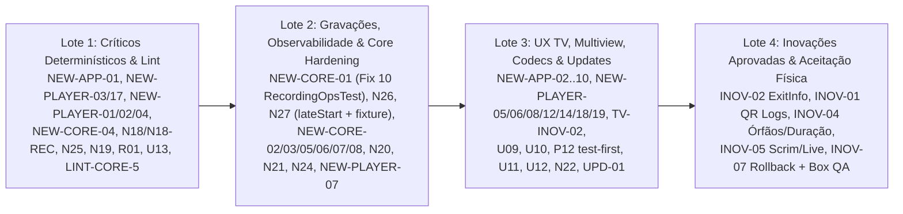

# Análise Técnica Abrangente — Novas Melhorias, Correções, Atualizações e Inovações (OwnTV TV & OwnTV Core)

**Data de referência:** 15 de novembro de 2026  
**Âmbito:** Auditoria técnica estática aprofundada, triagem de falsos positivos e consolidação crítica (*Council + 3 Especialistas: `:core`, `:player-core`, `:app`*) sem modificação de código-fonte, recursos XML, dependências, *snapshots* ou geração de APK.  
**Repositórios auditados:**
- **App (`OwnTV-main`):** `C:/Users/renat/Downloads/OwnTV-main/`
- **Core (`OwnTV_Core`):** `C:/Users/renat/Downloads/OwnTV_Core/`

> [!IMPORTANT]
> **Princípio de rigor desta revisão:** Nenhum item já implementado nos lotes entre 07/11/2026 e 14/11/2026 é reaberto como dívida de código. Cada proposta nova e antiga foi revalidada linha a linha contra os ficheiros reais, relatórios XML e logs de execução: falsos positivos foram descartados, falhas de desenho nas próprias correções sugeridas foram corrigidas antes de tocar em código, e inovações redundantes ou de alto risco em GPU TV foram despromovidas ou bloqueadas por *gates* explícitos.

---

## 1. Estado Atual Verificado do Sistema (Baseline Real em 15/11/2026)

### 1.1. Cadeia de Ferramentas, Dependências e Snapshot Ativo

Verificado diretamente em [`core-source-lock.json`](file:///C:/Users/renat/Downloads/OwnTV-main/core-source-lock.json), [`OwnTV-main/gradle/libs.versions.toml`](file:///C:/Users/renat/Downloads/OwnTV-main/gradle/libs.versions.toml) e [`OwnTV_Core/gradle/libs.versions.toml`](file:///C:/Users/renat/Downloads/OwnTV_Core/gradle/libs.versions.toml):

| Componente | Valor Verificado | Observação |
|---|---|---|
| Core Snapshot integrado | `1.0.57-own.20261011` (`1117` inputs) | SHA-256 `dda32fd9d2ef4442120e07570827ab88b4491228d271f04cf52368041d936021` (`vendor/owntv-core-source-dda32fd9...zip`) |
| Gradle Wrapper (App & Core) | `9.9.0` | Atualizado a 12/11/2026 ([registo](file:///C:/Users/renat/Downloads/OwnTV-main/docs/ATUALIZACAO_GRADLE_9.9.0_2026-11-12.md)) |
| Android Gradle Plugin (AGP) | `9.5.1` | Alinhado entre App e Core |
| Kotlin / Compose Compiler Plugin | `2.4.20` (KSP `2.3.11`) | Catálogos alinhados |
| Media3 | `1.11.1` | Atualizado com `AudioTrack` init / dynamic scheduling / 500 ms default PCM |
| `libmpv` AAR | `2026.11.0` | Integrado em `UP70-C` (30 bibliotecas nas 3 ABI; FFmpeg 9.0.2; DV perfil 5 quando há decoder) |
| Room / SQLite | Room `2.8.5`, `sqlite-bundled` `2.6.2` | Schema local Room **`51`**, formato de backup **`26`** (não equivalentes ao 53/26 upstream) |
| OkHttp / Coil / Coroutines | OkHttp `5.5.0`, Coil `3.6.0`, Coroutines `1.11.0` | Verificação estrita de checksums SHA-256 ativa |
| Extras Core | `zxing 3.5.4`, `juniversalchardet 2.5.0`, `koin 4.2.2` | Sem dependências novas nesta análise |

### 1.2. Trabalhos Recentemente Concluídos (Já Fechados — NÃO Reimplementar)

Confirmados por leitura direta de código-fonte e relatórios de execução de 07/11 a 14/11/2026:

1. **`B29` (Resolução nula/expirada em portal Stalker):** Já corrigido em [`LiveTuneController.kt`](file:///C:/Users/renat/Downloads/OwnTV_Core/player-core/src/main/java/tv/own/owntv/player/LiveTuneController.kt#L842-L855) — `resolveForTune` cancela `deadlineJob` e invoca `abandon(channel, detail, PlayerFailureReason.NETWORK)` em caso de timeout ou resultado nulo.
2. **Fases HLS/Áudio `1A`, `1C`, `1D`, `2A`, `2B`, `3A`, `3B` (07–08/11/2026):**
   - **1A:** [`HttpResponseDiagnostics.kt`](file:///C:/Users/renat/Downloads/OwnTV_Core/player-core/src/main/java/tv/own/owntv/player/HttpResponseDiagnostics.kt) e [`LivePreviewEngine.kt`](file:///C:/Users/renat/Downloads/OwnTV_Core/player-core/src/main/java/tv/own/owntv/player/LivePreviewEngine.kt) eliminaram `peekBody` bloqueante em respostas 200.
   - **1C:** `ProviderRetryGuard.kt` lê apenas bytes já em buffer em 408/429/503, sem esperar corpo completo.
   - **1D:** [`AudioOutputPolicy.kt`](file:///C:/Users/renat/Downloads/OwnTV_Core/player-core/src/main/java/tv/own/owntv/player/AudioOutputPolicy.kt) observa `onAudioTrackInitialized` / `onAudioTrackReleased` / underruns; `StreamInfo.kt` separa frequência de origem vs `AudioTrack`; [`AudioRouteSync.kt`](file:///C:/Users/renat/Downloads/OwnTV_Core/player-core/src/main/java/tv/own/owntv/player/AudioRouteSync.kt#L34-L47) já marca a rota como estimada (`estimated = true`, incluindo SDK 33+).
   - **2A:** [`StreamingHttpClient.kt`](file:///C:/Users/renat/Downloads/OwnTV_Core/core/src/main/java/tv/own/owntv/core/network/StreamingHttpClient.kt#L65) usa `.dispatcher(Dispatcher())` exclusivo para reprodução; `custom-core.settings.gradle.kts` usa `providers.fileContents(...)` para invalidar corretamente o cache de configuração Gradle.
   - **2B:** [`BoundedDns.kt`](file:///C:/Users/renat/Downloads/OwnTV_Core/core/src/main/java/tv/own/owntv/core/network/BoundedDns.kt) / `DnsConfig.kt` / `PlaybackDnsContext.kt` / [`StreamingHttpClient.kt`](file:///C:/Users/renat/Downloads/OwnTV_Core/core/src/main/java/tv/own/owntv/core/network/StreamingHttpClient.kt#L40-L47) aproveitam sucessos DNS tardios com contexto imutável (`networkId` + geração DNS).
   - **3A:** Remoção de `segmentRefusingHosts` global em [`LiveStreamQuirks.kt`](file:///C:/Users/renat/Downloads/OwnTV_Core/player-core/src/main/java/tv/own/owntv/player/LiveStreamQuirks.kt), `LiveRouting.kt` e `LiveTuneController.kt`; introdução de `HlsSegmentRefusals.kt` por tentativa e `MediaLoadRole.kt`.
   - **3B:** Textos clarificados de buffer/segmentos em `live_buffer_diagnostics.xml`, `ui_clarity.xml` e `StreamInfoOverlay.kt`.
3. **Fases `4A` e `4B` — Timeshift Local (09/11/2026):** `LocalTimeshiftTarget.kt`, [`LocalSegmentStore.kt`](file:///C:/Users/renat/Downloads/OwnTV_Core/core/src/main/java/tv/own/owntv/core/timeshift/LocalSegmentStore.kt), [`LocalTimeshiftSession.kt`](file:///C:/Users/renat/Downloads/OwnTV_Core/core/src/main/java/tv/own/owntv/core/timeshift/LocalTimeshiftSession.kt), `LocalTimeshiftInput.kt`, `LocalTimeshiftFailure.kt` e [`LiveViewModel.kt`](file:///C:/Users/renat/Downloads/OwnTV-main/app/src/main/java/tv/own/owntv/features/live/LiveViewModel.kt) implementam `EXT-X-TARGETDURATION` fixo na sessão, arredondamento RFC 8216, inspeção curta de stream AES/TS antes de escrita/eviction e `retainCopy()` + libertação do claim antes de avisar o utilizador.
4. **Integração Seletiva Core 1.0.70 + libmpv (`UP70-A`, `UP70-B1`, `UP70-C`) (08/11/2026):**
   - `U01`–`U05` (`HttpClient` máscara de MAC/URL curta Xtream, recusa explícita `authOk == false` / HTTP 513 antes de alterar catálogo, preservação atómica de `maxConnections` medido, `StoredRows` + `PositionParking.OFFSET = 4_294_967_296L` em `ChannelDao`/`MovieDao`/`SeriesDao`, e `ChannelResponseContext` canónico em `LivePreviewEngine`).
   - `U06` (`EpgRepository.storeProgrammes` chama `epgDao.upsertProgrammes(batch)` diretamente sem savepoint exterior).
   - `U08` (`libmpv 2026.11.0`).
   - *Nota sobre `U07 / B2`:* Avaliado via benchmark sintético (`benchmark_up70_b.py` + `test_preload_model.py`) e **rejeitado para ativação global** por piorar tempo (`22.1 ms -> 352.5 ms`) e memória (`4800 -> 96000` entradas) em feeds parciais `partial_12_of_240`.
5. **Melhorias Recentes na App (10–14/11/2026):**
   - **Logótipos Persistentes + Recuperação (10/11 e 12/11):** [`ChannelLogoDiskCache.kt`](file:///C:/Users/renat/Downloads/OwnTV-main/app/src/main/java/tv/own/owntv/ui/images/ChannelLogoDiskCache.kt), `ChannelLogoRepository.kt`, [`ChannelLogoImages.kt`](file:///C:/Users/renat/Downloads/OwnTV-main/app/src/main/java/tv/own/owntv/ui/images/ChannelLogoImages.kt), `LogoThumbnailSize.kt`, [`ChannelLogoWorker.kt`](file:///C:/Users/renat/Downloads/OwnTV-main/app/src/main/java/tv/own/owntv/ui/images/ChannelLogoWorker.kt) (miniaturas até `192 × 192` WebP/PNG ≤ 192 KiB, teto 64 MiB em `noBackupFilesDir/channel-logos`, originais até 8 MiB por blocos de 32 KiB, fallback à cache Coil em leitura offline, proteção XML/SVG).
   - **Recuo e Retoma em Diferidos (12/11):** `TimelineScrub.kt`, `MpvLoadCommand.kt`, [`OwnTVPlayer.kt`](file:///C:/Users/renat/Downloads/OwnTV_Core/player-core/src/main/java/tv/own/owntv/player/OwnTVPlayer.kt) (`mpvForLoad` nos seeks e play/pause; consolidação KeyDown/KeyUp em `VodTimeline`). *Nota:* A causa física de um reinício reportado numa box Google TV permanece por confirmar por falta de logs do instante da falha (`ExitInfo`).
   - **Letra 120% e Abertura Discreta (13/11):** `UiFontScale.DEFAULT = 120` em `FontCustomization.kt`; `PlayerHudVisibility.kt`, `ChannelIntroCard.kt`, [`TvAvoPlayerHud.kt`](file:///C:/Users/renat/Downloads/OwnTV-main/app/src/main/java/tv/own/owntv/player/TvAvoPlayerHud.kt).
   - **Ordem Personalizada na Lista Rápida (14/11):** `LiveZapList.kt`, `PagedZapIndex.kt` e `LiveViewModel.kt` respeitam posições manuais, agrupamento e ocultação sem rodar visualmente a janela nem reiniciar a emissão.

> [!WARNING]
> **Dívida transversal de validação física:** Nenhuma das alterações de 07/11 a 14/11 teve ainda **APK gerado/instalado** nem **ensaio físico nas boxes alvo** (incluindo os `androidTest` compilados e não corridos em dispositivo real). Adicionalmente, o Core possui **10 testes HLS falhados pré-existentes em `RecordingEngineOperationsTest`** (cuja causa raiz exata foi isolada nesta auditoria em `[NEW-CORE-01]`) e **5 erros pré-existentes de lint (`PluralsCandidate`)**.

---

## 2. Catálogo Técnico de Melhorias, Correções, Atualizações e Inovações Pendentes

Cada entrada abaixo distingue claramente: **Localização exata**, **Problema verificado no código**, **Correção / Especificação Técnica**, **Invariantes a Preservar** e **Critérios de Aceitação**.

---

### 2.1. Grupo I — Bugs Reais e Correções Determinísticas (Prioridade Crítica / Alta)

#### [NEW-CORE-01] Causa Raiz das 10 Falhas HLS em `RecordingEngineOperationsTest` & Risco `NO_SPACE` em Flash Interna vs Disco USB
- **Localização exata:**
  - [`RecordingEngine.kt:866, 920-921, 950, 1112, 1165, 1317, 1323, 1344`](file:///C:/Users/renat/Downloads/OwnTV_Core/core/src/main/java/tv/own/owntv/core/recording/RecordingEngine.kt#L866)
  - [`MediaTarget.kt:122`](file:///C:/Users/renat/Downloads/OwnTV_Core/core/src/main/java/tv/own/owntv/core/storage/MediaTarget.kt#L122), [`MediaStorageBudget.kt:196-199`](file:///C:/Users/renat/Downloads/OwnTV_Core/core/src/main/java/tv/own/owntv/core/storage/MediaStorageBudget.kt#L196-L199), [`StorageQuotaPolicy.kt:8-9`](file:///C:/Users/renat/Downloads/OwnTV_Core/core/src/main/java/tv/own/owntv/core/storage/StorageQuotaPolicy.kt#L8-L9)
  - [`RecordingEngineOperationsTest.kt:100-111`](file:///C:/Users/renat/Downloads/OwnTV_Core/core/src/test/java/tv/own/owntv/core/recording/RecordingEngineOperationsTest.kt#L100-L111)
  - Evidência observada em [`TEST-...RecordingEngineOperationsTest.xml`](file:///C:/Users/renat/Downloads/OwnTV-up70a-2026-11-08-220242/baseline-recording-results-final/TEST-tv.own.owntv.core.recording.RecordingEngineOperationsTest.xml) e [`baseline-classloading-confirmed.log`](file:///C:/Users/renat/Downloads/OwnTV-up70a-2026-11-08-220242/baseline-classloading-confirmed.log) (`lines 4035-4043`): apenas os 3 testes Raw TS passaram; os **10 testes HLS** falharam porque `RecordingEngine$hlsHasSpace$1` carregou aos `5.882s`, `MediaStorageBudget$Lease$reserve$1` aos `5.883s`, seguido imediatamente por `engineCancelWatcher$1` (`5.891s`) e `finishHlsSession$1` (`5.893s`), com **zero** carregamentos de `loadHlsPlaylist` ou `HlsSnapshot` (`RecordingFailure.NO_SPACE`).
- **Problema e gatilho (dois impactos — em testes e em produção):**
  1. Embora `RecordingEngineOperationsTest.kt:100-111` configure `StorageVolumeInfo.testResolver` com `free = 50 GiB` e `total = 100 GiB` (fazendo `storageBudget.reserveFloor(target)` devolver `maxOf(3 GiB, 100 GiB / 10) = 10 GiB = 10_737_418_240L`), `RecordingEngine.hlsHasSpace` (`:866`) chama `session.directory.usableSpace > storageBudget.reserveFloor(target) + copies * desired + next` diretamente sobre `java.io.File.usableSpace`, **contornando `StorageVolumeInfo.resolve(...)`**. O mesmo bypass ocorre em `target.usableSpace()` (`MediaTarget.kt:122`), `finishHlsSession` (`:920-921, 950`), `recordDash` (`:1112, 1165`) e `muxInto` (`:1317, 1323, 1344`). Os 3 testes Raw TS passavam porque `recordRaw` (`:591`) usa o limite fixo de `500 MB` via `RecordingRules.hasSpace`.
  2. **Bug real em box Android TV com armazenamento misto:** Se o diretório temporário de spool (`session.directory`) ficar na flash interna limitada da box (ex. 8 GB, ~4 GB livres) e o `target` final da gravação for um disco USB de 1 TB, `reserveFloor(target)` exige uma reserva proporcional ao disco de 1 TB (~50–100 GB) mas compara esse teto contra o `.usableSpace` da flash interna, falhando falsamente com `RecordingFailure.NO_SPACE` logo ao primeiro segmento HLS!
- **Correção recomendada:**
  1. Encaminhar todas as leituras de espaço disponível (`MediaTarget.usableSpace()`, `hlsHasSpace`, `finishHlsSession`, `recordDash`, `muxInto`) através de `StorageVolumeInfo.resolve(dir)` em vez de `File.usableSpace` cru.
  2. Calcular a folga de reserva (`reserveFloor`) de forma coerente por volume físico: o diretório temporário de spool não pode ser comparado contra a percentagem de reserva de um volume USB externo distinto do spool, reservando apenas o espaço necessário para o spool + cópia/mux segura.
- **Preservar:** `MediaStorageBudget` / leases atómicos e proteção genuína contra enchimento total da flash interna ou destino SAF.
- **Aceitação:** Os 13 testes de `RecordingEngineOperationsTest` passam sem alterar nem relaxar asserções, independentemente do espaço livre real do disco `C:` da máquina de compilação; teste novo comprovando gravação HLS bem-sucedida quando `session.directory` está num volume de 8 GB (4 GB livres) e `target` está num volume USB simulado de 1 TB.

---

#### [NEW-APP-01] Quebra de Contrato no *Modo TV Avó* ao Carregar `OK` Expõe a HUD Técnica Completa
- **Localização exata:**
  - [`PlayerHud.kt:219-224`](file:///C:/Users/renat/Downloads/OwnTV-main/app/src/main/java/tv/own/owntv/player/PlayerHud.kt#L219-L224)
  - [`TvAvoPlayerHud.kt:85, 98`](file:///C:/Users/renat/Downloads/OwnTV-main/app/src/main/java/tv/own/owntv/player/TvAvoPlayerHud.kt#L85)
- **Problema e gatilho:** Em `PlayerHud.kt:219-224`, a delegação para a interface simplificada faz `if (tvAvoMode && !visibility.controlsVisible) { TvAvoPlayerHud(...); return }`. Contudo, em `TvAvoPlayerHud.kt:85`, `TvAvoAction.SHOW` chama `if (!event.nativeKeyEvent.isCanceled) visibility.showControls()` (e `:98` já utiliza `showControls` para apresentar `compactInformation()`). No instante em que o utilizador sénior carrega em `OK`, `controlsVisible` passa a `true`, e no fotograma seguinte `PlayerHud` salta `TvAvoPlayerHud` (`!visibility.controlsVisible` passa a `false`), abrindo a **HUD técnica completa** (`TopBar`, `CenterControls`, `BottomBar`, seletores de motor/codec/resolução, etc.).
- **Correção recomendada:**
  1. Nunca sair para a HUD técnica completa enquanto `tvAvoMode == true`: manter `if (tvAvoMode) { TvAvoPlayerHud(...); return }` independentemente de `visibility.controlsVisible`.
  2. Gerir dentro de `TvAvoPlayerHud` o estado visível desencadeado por `controlsVisible == true` (`compactInformation()`, badge de pausa/reprodução simples e auto-ocultação por timeout), mantendo `TopBar`, definições avançadas, interruptores Exo/mpv e diálogos técnicos estritamente inacessíveis no *Modo TV Avó*.
- **Preservar:** Navegação D-Pad simplificada (`Cima/Baixo` zapping, `OK` cartão compacto/pausa conforme fluxo TV Avó, `Menu/Voltar`) e acessibilidade/fonte `120%`.
- **Aceitação:** Teste Compose UI verificando que pressionar `OK` (ação `SHOW`) com `tvAvoMode = true` exibe apenas a superfície/informação compacta de `TvAvoPlayerHud` e nunca monta `TopBar` nem controlos avançados do player.

---

#### [NEW-PLAYER-03] *(Promovido do antigo `N23`)* Crash Não Tratado (`IndexOutOfBoundsException`) em `FfmpegAudioDecoder.java`
- **Localização exata:** [`FfmpegAudioDecoder.java:146-154, 199-245`](file:///C:/Users/renat/Downloads/OwnTV_Core/player-core/src/main/java/tv/own/owntv/player/ffmpeg/FfmpegAudioDecoder.java#L146-L154)
- **Problema e gatilho:** Múltiplos acessos diretos sem verificação de limites:
  - `getExtraData()` faz `initializationData.get(0)`;
  - `getVorbisExtraData()` faz `initializationData.get(0)` e `initializationData.get(1)`;
  - `getAlacExtraData()` faz `initializationData.get(0)`;
  - `decode()` (`:151`) lê `extraData.length - 4` sem validar se `extraData != null && extraData.size >= 4` ou se os índices existem.
  Num stream IPTV com CSD (*codec-specific data*) incompleto ou faixa Vorbis/ALAC/AAC corrompida, o descodificador lança `IndexOutOfBoundsException` (exceção Java não verificada), derrubando o pipeline ExoPlayer sem dar oportunidade ao *AudioWatchdog* / fallback de atuar via `FfmpegDecoderException`.
- **Correção recomendada:** Validar presença e tamanho mínimo de `initializationData` e `extraData` em todos os helpers e no `decode()` antes de indexar; quando inválidos ou ausentes, lançar `FfmpegDecoderException` descritiva e verificada pelo contrato do Media3.
- **Preservar:** Caminhos normais de AAC, AC-3, E-AC-3, Vorbis, ALAC e MPEG-L2 sem alocações adicionais no hot-path de descodificação PCM.
- **Aceitação:** Testes unitários em `:player-core` com `Format` contendo `initializationData` vazia, `size == 1` em Vorbis, e `extraData` com `< 4` bytes comprovando conversão limpa para `FfmpegDecoderException` (zero `IndexOutOfBoundsException`).

---

#### [NEW-PLAYER-01] Perda Silenciosa de `playbackSourceId` em Rebuild, Retry e Retoma de Background
- **Localização exata:** [`LivePreviewEngine.kt:2063-2079, 2161-2176, 3039-3055, 3068-3084, 3518`](file:///C:/Users/renat/Downloads/OwnTV_Core/player-core/src/main/java/tv/own/owntv/player/LivePreviewEngine.kt#L2063-L2079)
- **Problema e gatilho:**
  - `rebuildForSettingChange()` (`:2063-2079`) constrói um novo `TuneRequest` omitindo `playbackSourceId = req?.playbackSourceId`.
  - Ambos os ramos de `retry()` (`:3039-3055` e `:3068-3084`) reconstroem o pedido sem `playbackSourceId`.
  - `onAppBackgrounded()` (`:2161-2176`) também o omite quando `currentTuneRequest == null` (apenas o ramo `req != null` que usa `req.copy(...)` o conserva).
  Quando `playbackSourceId` se perde nestes reinícios de reprodução, o escopo TLS personalizado da fonte (`PlaybackTls` em `:3518`) cai para o padrão e a comparação de identidade da fonte na promoção de canal em `LiveTuneController` falha silenciosamente.
- **Correção recomendada:** Preservar explicitamente `playbackSourceId = req?.playbackSourceId` (e fonte guardada em `currentSourceId` quando `currentTuneRequest == null`) em todas as reconstruções de `TuneRequest` de `LivePreviewEngine`.
- **Preservar:** Assinatura atual de `TuneRequest` e isolamento de cookies/TLS entre fontes distintas.
- **Aceitação:** Teste unitário garantindo que `playbackSourceId` sobrevive a `rebuildForSettingChange()`, `retry()` (ramos Exo e erro) e transição background/foreground.

---

#### [NEW-PLAYER-02] Handoff `Exo -> mpv` Contabilizado Falsamente Como Pausa Pelo Timer (`startAlarm`)
- **Localização exata:** [`LiveTuneController.kt:585-628, 868-876`](file:///C:/Users/renat/Downloads/OwnTV_Core/player-core/src/main/java/tv/own/owntv/player/LiveTuneController.kt#L585-L628)
- **Problema e gatilho:** Em `startOnMpv()`, `_liveOnExo.value = false` é escrito logo na linha `:585` — **antes** de `exoStopAndAwaitDrain()` (`:589`), `awaitExoRelease()` (`:597`), `resolveForTune()` (`:608`) e `mpvPlay()` (`:627`) — e sem limpar `engineAttemptStarted = false` (`:874`). Durante essa janela inteira de drenagem e resolução Stalker, como `mpvPlay` ainda não correu, `engines.mpvPlaybackRequested` permanece `false`. Assim, `playbackRequested()` (`:868-876`) devolve `false` mesmo nunca tendo havido pausa do utilizador, levando o `startAlarm()` a descontar/creditar o tempo de handoff como pausa intencional.
- **Correção recomendada:** Marcar estado transitório explícito de handoff ativo (`handingOffToMpv` ou manter estado de tentativa ativa até `mpvPlay` iniciar com `engineAttemptStarted = false` devidamente sincronizado) para que `playbackRequested()` continue `true` durante todo o arranque/handoff não pausado pelo utilizador.
- **Preservar:** Deteção genuína de pausa intencional do utilizador (`playbackRequested == false`) nos guardrails de reconexão e tempo máximo.
- **Aceitação:** Teste em `LiveTuneController` simulando handoff com `resolveForTune` lento (ex. 2 s) comprovando que `playbackRequested()` permanece `true` até à primeira resposta do `mpv` ou paragem explícita do utilizador.

---

#### [NEW-PLAYER-04] Perda de Faixas de Áudio e Legendas Externas em *Audio Fallback* e *Software Rescue*
- **Localização exata:** [`OwnTVPlayer.kt:2104-2134, 2171-2197`](file:///C:/Users/renat/Downloads/OwnTV_Core/player-core/src/main/java/tv/own/owntv/player/OwnTVPlayer.kt#L2104-L2134)
- **Problema e gatilho:** `onAudioFallback` (`:2104-2111`) e `onSoftwareRescue` (`:2119-2134`) reiniciam o ExoPlayer chamando `restartExoOnFreshSurface(url, ..., sub, restartGen)` com o parâmetro inicial obsoleto `sub` e nunca capturam a seleção atual de `_audioTrackList` / legenda externa ativa para `item.pendingExoAudio` e `item.pendingExoExternalSelect`. Se o utilizador escolheu áudio original/PT ou legenda externa antes de um fallback automático de decoder, a escolha perde-se após o reinício.
- **Correção recomendada:** Extrair um helper único de preservação de seleções antes de chamar `restartExoOnFreshSurface`, gravando a faixa de áudio selecionada em `item.pendingExoAudio` e a legenda ativa (interna/externa) antes do rebuild/rescue (e limpando apenas se houver troca explícita de canal).
- **Preservar:** Contrato existente de `sessionExternalSubs` (já protegido por `if (resetRetries)` em `:3080-3093`) e `restartGen`.
- **Aceitação:** Teste simulando seleção de 2.ª faixa de áudio e legenda externa antes de `onAudioFallback` / `onSoftwareRescue`, confirmando restauração automática após o rebuild.

---

#### [NEW-CORE-04] Pre-Auth OOM DoS e Falha de Bloqueio de Brute-Force de PIN em `CompanionHttpServer.kt`
- **Localização exata:** [`CompanionHttpServer.kt:240-280, 441-489, 578-590`](file:///C:/Users/renat/Downloads/OwnTV_Core/core/src/main/java/tv/own/owntv/core/companion/CompanionHttpServer.kt#L240-L280)
- **Problema e gatilho:**
  1. **OOM pré-autenticação:** `readLine` (`:578-590`) acumula bytes sem limite máximo de tamanho de linha, e o ciclo de leitura de cabeçalhos `while (true)` (`:240-246`) não limita a quantidade máxima de headers por pedido antes de verificar PIN/rota. Um cliente malicioso na LAN pode enviar uma linha infinita sem `\n` ou milhares de cabeçalhos e provocar `OutOfMemoryError` no processo da TV.
  2. **Bypass parcial de limite de PIN:** `pinRejected()` (`:481-489`) aplica o atraso `FAILED_PIN_DELAY_MS` antes de verificar `attempts >= MAX_PIN_ATTEMPTS`, e os endpoints `GET /`, `POST /` e `requirePin` (`:257, 275, 442`) não rejeitam imediatamente novas tentativas quando `failedPins.get() >= MAX_PIN_ATTEMPTS` já foi atingido.
- **Correção recomendada:**
  1. Impor limite estrito em `readLine` (ex. `8 KiB`) e número/tamanho máximo de headers por ligação HTTP (devolvendo HTTP `413` / `431` e encerrando o socket se excedido).
  2. Em `GET /`, `POST /` e `requirePin`, verificar `if (failedPins.get() >= MAX_PIN_ATTEMPTS)` logo à entrada (rejeição imediata com encerramento da sessão efémera sem executar trabalho adicional nem adiar o bloqueio em `pinRejected()`).
- **Preservar:** Fluxo legítimo de carregamento de backup / envio de lista por QR Code dentro da rede local com PIN válido.
- **Aceitação:** Testes unitários de socket enviando linha > cap, > max headers e > `MAX_PIN_ATTEMPTS` comprovando encerramento imediato com consumo de RAM constante.

---

#### [N18 + N18-REC] Omissão de `StreamHeaders.forSource` nos 3 Percursos Internos da App e na `RecordingEngine`
- **Localização exata:**
  - [`LiveViewModel.kt:351-355`](file:///C:/Users/renat/Downloads/OwnTV-main/app/src/main/java/tv/own/owntv/features/live/LiveViewModel.kt#L351-L355) (`watchWithLocalTimeshift` lê `StreamHeaders.decode(channel.httpHeaders)` e copia apenas `source.userAgent`, omitindo `source.httpReferer`).
  - [`LiveViewModel.kt:2689, 2707`](file:///C:/Users/renat/Downloads/OwnTV-main/app/src/main/java/tv/own/owntv/features/live/LiveViewModel.kt#L2689) (diferido interno lê apenas `sourceDao.getById(ch.sourceId)?.userAgent` e passa `ch.httpHeaders`).
  - [`LiveViewModel.kt:2893-2899, 2922`](file:///C:/Users/renat/Downloads/OwnTV-main/app/src/main/java/tv/own/owntv/features/live/LiveViewModel.kt#L2893-L2899) (arquivo/recuo lê apenas `source.userAgent`).
  - **`N18-REC` (Novo):** [`RecordingEngine.kt:530-534, 1521-1535`](file:///C:/Users/renat/Downloads/OwnTV_Core/core/src/main/java/tv/own/owntv/core/recording/RecordingEngine.kt#L530-L534) — `resolveTarget(row)` (`:1521-1535`) devolve apenas `Pair<String, String>` (`url to userAgent`) e ignora `source?.httpReferer` / `StreamHeaders.forSource(source, row.httpHeaders)` ao montar `headers` em `:531`.
  - *Referência funcional já existente:* Direto externo (`LiveViewModel.kt:2211`), diferido externo (`:2645`) e [`StreamHeaders.kt:18-22`](file:///C:/Users/renat/Downloads/OwnTV_Core/core/src/main/java/tv/own/owntv/core/network/StreamHeaders.kt#L18-L22).
- **Problema e gatilho:** Listas M3U/Xtream com `httpReferer` configurado ao nível da fonte (`SourceEntity.httpReferer`) tocam normalmente no direto, mas falham com HTTP 403/401 assimétricos em timeshift local, diferido interno, recuo **e gravações agendadas**.
- **Correção recomendada:** Usar `StreamHeaders.forSource(source, ...)` nos 3 chamadores de `LiveViewModel` e na resolução de target/headers da `RecordingEngine`, mantendo os cabeçalhos upstream exclusivamente no produtor `LocalTimeshiftSession` (nunca no URL loopback para `liveTuner.startLocalHls`).
- **Preservar:** Exclusão automática para `SourceType.STALKER` em `StreamHeaders.forSource`, overrides por canal, ordem de fecho e claims.
- **Aceitação:** Testes unitários em servidor local exigindo `Referer` no direto, timeshift local, diferido interno, arquivo e gravação (`RecordingEngine`) quando configurado apenas na `SourceEntity`.

---

#### [N25] Gatilho Espúrio de Restauro de Rede em Emissões `online = true` Já Ativas
- **Localização exata:** [`LivePreviewEngine.kt:945-950, 958-967`](file:///C:/Users/renat/Downloads/OwnTV_Core/player-core/src/main/java/tv/own/owntv/player/LivePreviewEngine.kt#L945-L950) e [`DefaultNetworkTracker.kt:4-13`](file:///C:/Users/renat/Downloads/OwnTV_Core/core/src/main/java/tv/own/owntv/core/network/DefaultNetworkTracker.kt#L4-L13).
- **Problema e gatilho:** `connectivity.state.onEach { network -> ... if (network.online) onNetworkRestored() }` dispara sempre que há emissão com `online == true`. Mudanças apenas de metadados (`metered` `false ↔ true`, transporte ou reconciliação no mesmo `networkId`) após `tune.gaveUp == true` limpam `tune.gaveUp = false; tune.retryCount = 0` e chamam `reconnect("network restored")` sem ter havido queda/restauro de rede.
- **Correção recomendada:** Tratar apenas no consumidor `LivePreviewEngine`: guardar `lastObservedOnline: Boolean?` e `lastOnlineNetworkId: Long?`, invocando `onNetworkRestored()` apenas em transição `false -> true` ou troca efetiva para um `networkId` distinto (`network.networkId != null && network.networkId != lastOnlineNetworkId`).
- **Preservar:** Guards de `onNetworkRestored()` (`ownership.suspended`, `_playbackRequested`, `stoppingIntentionally`, pausa do utilizador).
- **Aceitação:** Teste JVM provando 0 reconexões em variações `metered` dentro do mesmo `networkId` e 1 reconexão em `false -> true` ou mudança de `networkId`.

---

#### [N19] FPS Medido Antigo Sobrevive a Mudanças de Cadência (*Correção Refinada: Invocar `restartFpsMeasurement()`*)
- **Localização exata:** [`LivePreviewEngine.kt:476-487, 801, 806-814, 990, 998-1003`](file:///C:/Users/renat/Downloads/OwnTV_Core/player-core/src/main/java/tv/own/owntv/player/LivePreviewEngine.kt#L998-L1003), [`MpvVideoSurface.kt:182-186`](file:///C:/Users/renat/Downloads/OwnTV-main/app/src/main/java/tv/own/owntv/player/MpvVideoSurface.kt#L182-L186) e precedente em [`ExoSubtitleEngine.kt:205-214`](file:///C:/Users/renat/Downloads/OwnTV_Core/player-core/src/main/java/tv/own/owntv/player/ExoSubtitleEngine.kt#L205-L214).
- **Problema e gatilho:** `onVideoInputFormatChanged` (`:476-487`) regista apenas log, mantendo `measuredPtsFps` e `fpsSample.lastFps` antigos dominantes em `displayFps(f)` (`:801`) após troca dinâmica 25 ↔ 50 fps no mesmo canal. **Descoberta adicional do Council:** `restartFpsMeasurement()` (`:998-1003`) chama `fpsSample.resetWindow()` mas o ciclo `fpsFastRefresh` pára quando `done = precise != null || fpsAttempts >= FPS_MAX_ATTEMPTS` (`:990`). Limpar apenas `measuredPtsFps = null` e o acumulador em `onVideoInputFormatChanged` **não reativa** a recolha se a primeira medição da sintonia já tiver terminado!
- **Correção recomendada:**
  1. Guardar assinatura mínima de cadência/geometria atual (`sampleMimeType`, `width`, `height`, `frameRate` declarado), ignorando alterações só de `bitrate` ABR.
  2. Ao detetar mudança de cadência/geometria com `owns(eventTime)`, limpar `measuredPtsFps = null`, fazer reset completo do acumulador de PTS e `fpsSample`, **e invocar explicitamente `restartFpsMeasurement()`** para rearmar `fpsFastRefresh` desde `fpsAttempts = 0`.
  3. Publicar atualização em `_videoFps` apenas após estabilização e respeitando o cooldown AFR existente.
- **Preservar:** Sem reinício em trocas de degrau ABR de bitrate; respeitar `autoFrameRate = false` nos previews em scroll.
- **Aceitação:** Testes para `25 -> 50 fps` após a janela inicial de medição ter fechado (`done == true`), `23.976` / `59.94`, troca só de bitrate (sem reset), e descarte de eventos fora do token atual.

---

#### [N20] Heurística Demasiado Permissiva de PTS Inválido no `mpv` (`BROKEN_PTS_RX`)
- **Localização exata:** [`OwnTVPlayer.kt:466-469, 478, 1480-1481, 1505-1514, 5542-5543`](file:///C:/Users/renat/Downloads/OwnTV_Core/player-core/src/main/java/tv/own/owntv/player/OwnTVPlayer.kt#L466-L469).
- **Problema e gatilho:** `BROKEN_PTS_RX = Regex("invalid video timestamp|non-monotonic|desynchroni", RegexOption.IGNORE_CASE)` e `++load.brokenPtsHits >= BROKEN_PTS_HITS` (`20`) somam avisos indefinidamente ao longo de toda a duração da visualização sem janela temporal nem distinção áudio vs vídeo, ativando falsamente `video-sync=desync`, `framedrop=no` e `correct-pts=no`.
- **Correção recomendada:** Estreitar `BROKEN_PTS_RX` para erros de PTS/DTS de vídeo/demuxer específicos (excluindo avisos genéricos de dessincronização apenas informativos) e exigir densidade temporal numa janela deslizante por relógio monotónico vinculada ao token de load, com decaimento após reprodução saudável contínua.
- **Preservar:** Workaround ativo para streams genuinamente quebrados via `LiveStreamQuirks` em RAM por sessão.
- **Aceitação:** Teste JVM demonstrando 20 avisos espaçados / áudio sem ativar `desync`, vs rajada densa patológica ativando isoladamente apenas no load/stream respetivo.

---

#### [R01] Cabeçalhos HTTP com Vírgula no `mpv` (*Correção Refinada: Usar `change-list`, Não `%len%`*)
- **Localização exata:** [`StreamHeaders.kt:78-84`](file:///C:/Users/renat/Downloads/OwnTV_Core/core/src/main/java/tv/own/owntv/core/network/StreamHeaders.kt#L78-L84) e [`OwnTVPlayer.kt:3583`](file:///C:/Users/renat/Downloads/OwnTV_Core/player-core/src/main/java/tv/own/owntv/player/OwnTVPlayer.kt#L3583).
- **Problema e falha na correção anterior:** `toMpvHeaderFields` descarta qualquer header com vírgula (`.filter { !it.value.contains(',') }`), perdendo `Cookie` múltiplos, `Accept` ou `User-Agent` personalizados com vírgulas porque `setPropertyString("http-header-fields", ...)` usa a vírgula como delimitador. **Correção do Council ao plano anterior:** A sintaxe length-prefixed `%<len>%` só funciona em `mpv_command_string`, **NÃO** em `mpv_set_property_string`! Adotá-la em `setPropertyString` enviaria literais `%len%` no cabeçalho HTTP.
- **Correção recomendada:** Em `OwnTVPlayer.kt:3583`, substituir `setPropertyString("http-header-fields", ...)` por comandos nativos da lista mpv:
  1. `MPVLib.command(arrayOf("change-list", "http-header-fields", "clr", ""))`
  2. Para cada header sanitizado (rejeitando `\r` e `\n` e excluindo `User-Agent`), `MPVLib.command(arrayOf("change-list", "http-header-fields", "append", "$name: $value"))`.
- **Preservar:** Remoção/sanitização CRLF, gestão separada de `User-Agent`, e limpeza ao trocar de canal.
- **Aceitação:** Teste end-to-end local com `OwnTVPlayer`/`MockWebServer` comprovando recebimento intacto de `Cookie: a=1, b=2` e `X-Custom: foo,bar` em simultâneo.

---

#### [U13] Criação e Edição de Avatar em `ProfileManager` Sem Mutex & Herança de Fontes PIN
- **Localização exata:** [`ProfileManager.kt:33, 36, 49-61, 80, 104-125, 132`](file:///C:/Users/renat/Downloads/OwnTV_Core/core/src/main/java/tv/own/owntv/core/profile/ProfileManager.kt#L33-L132).
- **Problema e gatilho (âmbito ampliado após leitura direta):** `switchTo` (`:36`), `edit` (`:80`) e `delete` (`:132`) protegem-se com `mutationMutex.withLock`, mas **`create` (`:49-61`), `setCustomAvatar` (`:104-114`) e `clearCustomAvatar` (`:122-125`) NÃO adquirem `mutationMutex`**. Em paralelo, `create` executa `sourceDao.allSourceIds().forEach { sourceDao.link(...) }` incondicionalmente, expondo listas exclusivas de perfis com PIN a perfis novos ou infantis sem PIN.
- **Correção recomendada:**
  1. Envolver `create`, `setCustomAvatar` e `clearCustomAvatar` em `mutationMutex.withLock`.
  2. Em `create`, excluir fontes ligadas exclusivamente a perfis com `pinHash != null` (seguindo herança segura sem importar locks complexos incompatíveis com schema 51).
  3. Ao eliminar perfis ou limpar avatares, assegurar integridade e limpeza de preferências/ficheiros órfãos do perfil.
- **Preservar:** Herança normal de fontes públicas quando não há restrição por PIN; total compatibilidade schema `51` / backup `26`.
- **Aceitação:** Teste verificando proteção das fontes exclusivas de perfil PIN aquando da criação de perfil aberto/infantil, e serialização segura sob criação/edição de avatar concorrente.

---

#### [N26] Contrato Booleano em `HlsSegmentRetry` Ignora `Retry-After > 10s` em Gravações HLS *(Confirmado Real)*
- **Localização exata:** [`HlsSegmentRetry.kt:30, 40, 64`](file:///C:/Users/renat/Downloads/OwnTV_Core/core/src/main/java/tv/own/owntv/core/recording/HlsSegmentRetry.kt#L30-L64) e [`RecordingEngine.kt:728-735, 775-779`](file:///C:/Users/renat/Downloads/OwnTV_Core/core/src/main/java/tv/own/owntv/core/recording/RecordingEngine.kt#L728-L779).
- **Problema e gatilho:** Verificado diretamente contra o ficheiro atual (contrariando suspeita infundada de já estar corrigido): `MAX_WAIT_MS = 10_000L` (`:30`), `capture(...) : Boolean` (`:40`), e `if (serverDelay > MAX_WAIT_MS) return false` (`:64`). Quando devolve `false`, `RecordingEngine` executa `session.skip(...)` e pede o segmento seguinte de imediato, desrespeitando `Retry-After` do servidor.
- **Correção recomendada:** Substituir `Boolean` por `sealed interface Outcome` (`Captured`, `Skipped`, `ProviderWait(delayMs, code)`) preservando `serverDelay` no produtor `recordHls` com espera cancelável cooperativa — **nunca** converter erro terminal 403/404 de um único segmento em falha global que reinicie a gravação inteira.
- **Preservar:** Cancelamento cooperativo imediato, `HlsCaptureCompleteness.missingWindow`, gravações em ficheiro único e multipartes SAF.
- **Aceitação:** Teste com múltiplos segmentos em `429 Retry-After: 30` garantindo respeito pela espera/cancelamento sem martelar o fornecedor nem quebrar gravações normais.

---

#### [N27] Gravação HLS em Estagnação Até `stopMs` + Bug Confirmado em `HlsCaptureCompleteness.lateStart`
- **Localização exata:**
  - [`HlsCaptureCompleteness.kt:4-18`](file:///C:/Users/renat/Downloads/OwnTV_Core/core/src/main/java/tv/own/owntv/core/recording/HlsCaptureCompleteness.kt#L4-L18) (`lateStart` na linha `14`; `intended` na linha `15`).
  - [`RecordingEngine.kt:660-745`](file:///C:/Users/renat/Downloads/OwnTV_Core/core/src/main/java/tv/own/owntv/core/recording/RecordingEngine.kt#L660-L745).
- **Problema e gatilho (duas componentes verificadas):**
  1. **Bug isolado confirmado em `HlsCaptureCompleteness.kt:14`:** A linha `:15` (`intended`) já usa corretamente `maxOf(startedAtMs, programmeStartMs)`, mas a linha `:14` calcula `val lateStart = startedAtMs > programmeStartMs && startedAtMs - programmeStartMs > tolerance`. Logo, qualquer gravação manual iniciada no meio de um programa (`startedAtMs > programmeStartMs`) é marcada como `PARTIAL` mesmo após gravar 100% desde `startedAtMs` até `programmeStopMs`!
  2. **Loop sem progresso:** Em `RecordingEngine.recordHls` (`:660-745`), se a playlist estagnar na mesma sequência ou reiniciar repetidamente abaixo de `session.lastSequence` (`:720`), continua a sondar até `row.stopMs`.
- **Correção recomendada:**
  1. *Pré-requisito obrigatório:* Fechar primeiro `[NEW-CORE-01]` (os 10 testes de `RecordingEngineOperationsTest`).
  2. Corrigir `HlsCaptureCompleteness.lateStart` comparando o início real da captura contra o início planeado da gravação (`row.startMs`) em gravações manuais/tardias, mantendo integridade em gravações agendadas desde o início do programa.
  3. Para o loop de estagnação, criar primeiro a *fixture* isolada `RecordingHlsProgressTest.kt` sob critério *"Testar primeiro"*, descontando obrigatoriamente tempos de `N26`, pausa e offline.
- **Preservar:** Segmentos válidos já gravados e `HlsCaptureCompleteness.missingWindow`.
- **Aceitação:** Teste unitário provando captura manual iniciada a meio de um programa marcada como completa (quando gravada até ao fim sem falhas de janela) + passagem da fixture de estagnação sem falsos cortes em pausa/offline/Retry-After.

---

#### [LINT-CORE-5] 5 Erros Pré-Existentes de `PluralsCandidate` no Lint Integral do Core
- **Localização exata:** [`core-full-lint-preexisting-errors.json`](file:///C:/Users/renat/Downloads/OwnTV-fase2a-2026-11-07-121345/core-full-lint-preexisting-errors.json):
  1. `core/src/main/res/values/channel_playback.xml:5` (`"%d"` + `"customized"`)
  2. `core/src/main/res/values/recording_capture.xml:9` (`"%d"` + `"gaps"`)
  3. `core/src/main/res/values/strings_settings.xml:2464` (`"%d"` + `"recent"`)
  4. `core/src/main/res/values/strings_settings.xml:2472` (`"%d"` + `"direct"`)
  5. `core/src/main/res/values/visual_performance.xml:11` (`"%d"` + `"above"`)
- **Problema e correção:** Bloqueia aprovação limpa de `:core:lintDebug` / `:core:lintRelease`. Migrar para `<plurals>` corretos (com traduções `values-pt` e idiomas ativos + chamadores `getQuantityString`), sem usar `lint-baseline.xml` nem `tools:ignore="PluralsCandidate"`.

---

### 2.2. Grupo II — Bugs Médios Recém-Descobertos, Robustez, Compatibilidade & Suites de Teste

#### [NEW-CORE-02] `require` Estrito em `LocalSegmentStore.validateDuration` Derruba Sessões de Timeshift Local
- **Localização exata:** [`LocalSegmentStore.kt:32-42`](file:///C:/Users/renat/Downloads/OwnTV_Core/core/src/main/java/tv/own/owntv/core/timeshift/LocalSegmentStore.kt#L32-L42).
- **Problema:** `validateDuration` (`:41`) executa `require(LocalTimeshiftTarget.roundedSeconds(durationMs) <= it)`. Se um stream IPTV ao vivo emitir pontualmente um segmento ligeiramente mais longo do que o `EXT-X-TARGETDURATION` inicial declarado na playlist, `require` lança `IllegalArgumentException` não tratada, derrubando toda a sessão de timeshift local.
- **Correção recomendada:** Tratar aumento legítimo de duração atualizando/registando limite conforme tolerância da sessão de timeshift ou devolvendo falha controlada de domínio (`LocalTimeshiftFailure`), nunca abortando com `IllegalArgumentException` crua.

#### [NEW-CORE-03] Expiração Prematura em `BoundedDns.fallback()` e Possível Saturação do Pool DNS
- **Localização exata:** [`BoundedDns.kt:35-36, 60, 72`](file:///C:/Users/renat/Downloads/OwnTV_Core/core/src/main/java/tv/own/owntv/core/network/BoundedDns.kt#L35-L36).
- **Problema:** `fallback()` (`:36`) reavalia `valid(it)` após esperar `cachedWaitMs` (1 s). Se a entrada em cache expirar durante esse mesmo segundo de espera, lança `UnknownHostException` logo a 1 s em vez de devolver `previous` (*stale-while-error*) ou esperar o orçamento restante de 5 s. Adicionalmente, `EXECUTOR` (`:72`) usa pool fixo de 4 threads partilhado — 4 hosts inacessíveis bloqueados em `Dns.SYSTEM` podem esgotar todas as threads DNS para novos canais.
- **Correção recomendada:** Capturar o valor `previous` válido ou utilizável em `fallback` conforme política stale-while-error sem falhar prematuramente ao fim de 1 s, e dotar o pool de resolução de guarda/concorrência limitada por host ou threads suficientes/não bloqueantes em cascata.

#### [NEW-CORE-05] 4 Bugs no Pipeline de Logótipos Persistentes (`EpgLogoStore`, `ChannelLogoWorker`, `ChannelLogoDiskCache`, `ChannelLogoImages`)
- **Localização exata:**
  1. [`EpgLogoStore.kt:42`](file:///C:/Users/renat/Downloads/OwnTV_Core/core/src/main/java/tv/own/owntv/core/epg/EpgLogoStore.kt#L42): `rows.associate { ... }` sobrescreve entradas anteriores pelo **último** feed, ao contrário do comentário das linhas `:40-41` que pretende dar prioridade ao **primeiro** feed. Usar `putIfAbsent`.
  2. [`ChannelLogoWorker.kt:47, 62`](file:///C:/Users/renat/Downloads/OwnTV-main/app/src/main/java/tv/own/owntv/ui/images/ChannelLogoWorker.kt#L47): `if (active.size >= 8192) return Result.success()` termina antes de invocar `repository.prune(active)` (`:62`), impedindo limpeza de disco em listas com > 8192 canais. Deve manter `prune(active)` e limitar apenas os refreshes/descargas ao teto de 8192.
  3. [`ChannelLogoDiskCache.kt:60-72`](file:///C:/Users/renat/Downloads/OwnTV-main/app/src/main/java/tv/own/owntv/ui/images/ChannelLogoDiskCache.kt#L60-L72): `save()` escreve `$key-$revision.$format` sem apagar a revisão anterior do mesmo `key` antes de verificar `maxBytes` (`:68-72`), ocupando quota em duplicado e provocando eviction prematura de outros logótipos.
  4. [`ChannelLogoImages.kt:51-61`](file:///C:/Users/renat/Downloads/OwnTV-main/app/src/main/java/tv/own/owntv/ui/images/ChannelLogoImages.kt#L51-L61): Quando `Bitmap.createScaledBitmap` (`:52`) cria uma cópia redimensionada (`bitmap !== original`), `bitmap` não é reciclado explicitamente (`bitmap.recycle()` após compressão).

#### [NEW-CORE-06] Normalização Desalinhada em `LiveEpgReader` Quebra `EpgDedupe` com Histórico Xtream
- **Localização exata:** [`LiveEpgReader.kt:259-270`](file:///C:/Users/renat/Downloads/OwnTV_Core/core/src/main/java/tv/own/owntv/core/live/LiveEpgReader.kt#L259-L270).
- **Problema:** O ramo histórico Xtream (`:261`) utiliza `channel.epgChannelId ?: remoteId` sem normalização (`trim`/`lowercase`), enquanto os feeds XMLTV e short-EPG armazenados (`:269-270`) passam pelo `epgMatchResolver` normalizado. Consequentemente, `EpgDedupe` falha a igualdade (`a.epgChannelId != b.epgChannelId`) entre eventos históricos e atuais do mesmo canal.
- **Correção recomendada:** Normalizar `epgChannelId` na leitura histórica através do mesmo normalizador usado em `epgMatchResolver` sem alterar chaves persistidas existentes na BD.

#### [NEW-CORE-07] Banner Espúrio Pós-Rollback de Backup, N+1 em `UserDataResolver` e `.trim()` em `EpgSourceStore`
- **Localização exata:**
  1. [`BackupManager.kt:904, 917-945`](file:///C:/Users/renat/Downloads/OwnTV_Core/core/src/main/java/tv/own/owntv/core/backup/BackupManager.kt#L904): `markRestoreStarted(...)` persiste estado em preferências **antes** de `db.transaction` (`:917`). Se `ProfileProtectionAuthorizationException` (`:941`) abortar a transação (fazendo rollback limpo no SQLite), o marcador persistido sobrevive e exibe na UI um falso aviso de restauro interrompido.
  2. [`UserDataResolver.kt:533`](file:///C:/Users/renat/Downloads/OwnTV_Core/core/src/main/java/tv/own/owntv/core/backup/UserDataResolver.kt#L533): Invoca `profileDao.getById(pid)` dentro de ciclo durante relink em massa, gerando queries N+1 em vez de cache/lookup único em Set de IDs de perfis carregados uma vez.
  3. [`EpgSourceStore.kt:71-72`](file:///C:/Users/renat/Downloads/OwnTV_Core/core/src/main/java/tv/own/owntv/core/epg/EpgSourceStore.kt#L71-L72): `ensure()` compara `it.url == url` sem `.trim()`, ao contrário de `add()` (`:58`), permitindo registar fontes duplicadas por espaços nas extremidades.

#### [NEW-CORE-08] Falha Transiente Interrompe Permanentemente Atualização de Rede DNS em `StreamingHttpClient`
- **Localização exata:** [`StreamingHttpClient.kt:40-46`](file:///C:/Users/renat/Downloads/OwnTV_Core/core/src/main/java/tv/own/owntv/core/network/StreamingHttpClient.kt#L40-L46).
- **Problema:** Dentro do bloco lazy de `liveDns`, capturar qualquer `Exception` não canceladora no corpo de `collect` sai do collector de `networkStates.collect`, deixando `liveDnsContext` congelado na geração anterior até reiniciar o processo.
- **Correção recomendada:** Isolar tratamento de exceções no interior de cada emissão de `networkStates.collect` (sem abortar a corrotina coletora), mantendo sempre o propagate de `CancellationException`.

#### [NEW-APP-02] Salto Espúrio de Foco ao Regressar ao Ecrã de Gravações / Downloads
- **Localização exata:** [`DownloadsScreen.kt:98, 105-113, 173-183`](file:///C:/Users/renat/Downloads/OwnTV-main/app/src/main/java/tv/own/owntv/features/downloads/DownloadsScreen.kt#L98), [`RecordingsViewModel.kt:105, 240`](file:///C:/Users/renat/Downloads/OwnTV-main/app/src/main/java/tv/own/owntv/features/recordings/RecordingsViewModel.kt#L105) e [`RecordingsScreen.kt:126-143`](file:///C:/Users/renat/Downloads/OwnTV-main/app/src/main/java/tv/own/owntv/features/recordings/RecordingsScreen.kt#L126-L143).
- **Problema:** `RecordingsViewModel.lastPlayedId` (`:105, 240`) nunca é consumido em `RecordingsScreen.kt`, e `DownloadsScreen.kt` fixa `tab = DownloadsTab.LIVE` e `shown = emptyList()` (`:98, 110`). Ao restaurar foco (`:175`), `if (shown.isEmpty())` invoca `tabFocus.requestBoundedFocus(actionFocusGuard); onRestored()`, atirando o foco D-Pad para o chip do separador no topo sempre que o utilizador sai de uma gravação reproduzida.
- **Correção recomendada:** Consumir `lastPlayedId` (ou alvo ativo do separador de gravações) para restaurar foco diretamente sobre o cartão/linha da gravação reproduzida antes de fazer fallback ao separador.

#### [NEW-APP-03] `clearType(MediaType.LIVE)` Limita Histórico de Canais ao Vivo a Apenas 1 Entrada
- **Localização exata:** [`LiveViewModel.kt:2520-2521`](file:///C:/Users/renat/Downloads/OwnTV-main/app/src/main/java/tv/own/owntv/features/live/LiveViewModel.kt#L2520-L2521).
- **Problema:** `recordLiveHistory` executa `historyDao.clearType(pid, MediaType.LIVE)` imediatamente antes de `historyDao.record(...)`, apagando todo o histórico de canais vistos antes de inserir o canal atual. Como `HistoryDao.record` já faz deduplicação por item, este `clearType` reduz listas como `recentlyWatched(..., 20)` e `historyChannels(30)` a no máximo **1 canal**.
- **Correção recomendada:** Remover a chamada destrutiva `historyDao.clearType(pid, MediaType.LIVE)` (respeitando limpeza apenas por ação explícita do utilizador ou política de retenção máxima em janela).

#### [NEW-APP-04] `FLAG_KEEP_SCREEN_ON` Ignora Modo Áudio e Multiview `soundOnly` em ExoPlayer
- **Localização exata:** [`MainActivity.kt:275-279`](file:///C:/Users/renat/Downloads/OwnTV-main/app/src/main/java/tv/own/owntv/MainActivity.kt#L275-L279).
- **Problema:** `val playing by player.isPlaying.collectAsStateWithLifecycle()` observa exclusivamente o `OwnTVPlayer` (`mpv`). Em reprodução ExoPlayer `PlayerMode.AUDIO` ou Multiview `soundOnly`, `ExoPreviewSurface` é desmontado e o estado ativo do ExoPlayer não é observado na `MainActivity`, desativando `FLAG_KEEP_SCREEN_ON` e permitindo que o ecrã/box entre em suspensão a meio da emissão.
- **Correção recomendada:** Combinar estado de reprodução ativa de `OwnTVPlayer` **e** dos motores ExoPlayer ativos/rádio (`isPlaying`) na condição que mantém `FLAG_KEEP_SCREEN_ON` durante emissão intencional.

#### [NEW-PLAYER-05] Leak de Listeners e Bypass de `precisePtsFps` em `ExoSubtitleEngine.kt`
- **Localização exata:** [`ExoSubtitleEngine.kt:218-221, 240-246, 361`](file:///C:/Users/renat/Downloads/OwnTV_Core/player-core/src/main/java/tv/own/owntv/player/ExoSubtitleEngine.kt#L218-L246).
- **Problema:**
  1. `onVideoSizeChanged` (`:245`) chama `player?.videoFormat?.frameRate?.let { ... callbacks.onVideoFps(it) }`, contornando `currentFps()` (`precisePtsFps` definido em `:218-221`) e reportando `frameRate` bruto mesmo quando já existe medição PTS precisa.
  2. `start()` (`:361`) chama `player?.release()` sem antes executar `removeAnalyticsListener(analytics)` e `removeListener(listener)` da instância anterior.
- **Correção recomendada:** Invocar `currentFps()` (em vez do `frameRate` bruto) ao notificar `callbacks.onVideoFps(...)` em `onVideoSizeChanged`, e remover explicitamente `analytics` + `listener` antes de libertar `player` em `start()`.

#### [NEW-PLAYER-06] Inversão de Qualidade em Tiles Visíveis Durante Multiview `soundOnly`
- **Localização exata:** [`LiveEnginePool.kt:76-102`](file:///C:/Users/renat/Downloads/OwnTV_Core/player-core/src/main/java/tv/own/owntv/player/LiveEnginePool.kt#L76-L102).
- **Problema:** `setSoundOnly(tile, true)` delega para `giveSoundTo(tile)`, cujo código (`:82`) atribui `setMaxVideoHeight(null)` precisamente ao mosaico com áudio (que nem sequer exibe vídeo por estar em `soundOnly`!) e capa os restantes mosaicos **com vídeo visível** a `BACKGROUND_TILE_HEIGHT`.
- **Correção recomendada:** Aplicar cap mínimo ou desativação de faixa de vídeo adequada ao tile marcado como `soundOnly == true`, mantendo qualidade completa/prioritária nos tiles visíveis.

#### [N21] Telemetria Agregada de Atraso de Processamento de Vídeo (`onVideoFrameProcessingOffset`)
- **Localização exata:** Listener `analytics` em [`LivePreviewEngine.kt:455-504`](file:///C:/Users/renat/Downloads/OwnTV_Core/player-core/src/main/java/tv/own/owntv/player/LivePreviewEngine.kt#L455-L504).
- **Melhoria:** Implementar `onVideoFrameProcessingOffset(eventTime: EventTime, totalProcessingOffsetUs: Long, frameCount: Int)` (Media3 `1.11.1`) validando `owns(eventTime)` e `frameCount > 0`, agregando apenas no resumo diagnóstico quando `LiveDiagnosticsLog.enabled == true` (separa gargalo de rede vs GPU/descodificador sem **nunca** acionar troca de motor nem degradação automática).

#### [P12] Elegibilidade de Áudio FFmpeg nas Variantes do Timeshift Local
- **Localização exata:** [`HlsVariantSupport.kt:8-48`](file:///C:/Users/renat/Downloads/OwnTV_Core/core/src/main/java/tv/own/owntv/core/timeshift/HlsVariantSupport.kt#L8-L48), [`ExoAudioSupport.kt:10-20`](file:///C:/Users/renat/Downloads/OwnTV_Core/player-core/src/main/java/tv/own/owntv/player/ExoAudioSupport.kt#L10-L20), [`LocalTimeshiftSession.kt:30, 161`](file:///C:/Users/renat/Downloads/OwnTV_Core/core/src/main/java/tv/own/owntv/core/timeshift/LocalTimeshiftSession.kt#L30), [`LiveTuneController.kt:192, 253-257`](file:///C:/Users/renat/Downloads/OwnTV_Core/player-core/src/main/java/tv/own/owntv/player/LiveTuneController.kt#L253-L257).
- **Melhoria (critério *"Testar primeiro"*):** Após reproduzir caso real em que uma variante AC-3/E-AC-3/DTS/MP2 seja recusada por `MediaCodecList(REGULAR_CODECS)` mas toque em FFmpeg local, injetar via callback `variantSupported` em `LocalTimeshiftSession` a verificação combinada (`plataforma || FfmpegAudio.supports(mime)`), sem criar dependência circular `:core <-> :player-core`.

#### [U09] Templates M3U Legados `${(b)...}` / `${(e)...}` e Token `'y'` em `CatchupUrl` *(Âmbito Refinado)*
- **Localização exata:** [`CatchupUrl.kt:46, 93, 100-115`](file:///C:/Users/renat/Downloads/OwnTV_Core/core/src/main/java/tv/own/owntv/core/epg/CatchupUrl.kt#L46-L115).
- **Observação verificada no código:** `NOW_TOKENS`, `offset`, `duration` e `{utc:FMT}` **já estão implementados**. O que realmente falta é:
  1. Em `CatchupUrl.kt:46`, `TOKEN = Regex("\\$?\\{([A-Za-z_][A-Za-z0-9_-]*)(?::([^}]*))?\\}")` exclui `(` na classe inicial `[A-Za-z_]`, falhando em `${(b)...}` e `${(e)...}` (incluindo sufixo `:utc`).
  2. `DATE_LETTERS = "YmdHMS"` (`:93`) e `formatUtc` (`:100-115`) não suportam o especificador de ano a 2 dígitos `'y'`.
- **Correção recomendada:** Estender apenas a regex/tokenização para aceitar `${(b)...}` / `${(e)...}` e adicionar `'y'` a `DATE_LETTERS`/`formatUtc`, preservando integralmente fuso horário efetivo, `catchupCorrectionMin` e URL encoding em `resolveTemplate`.

#### [U10] Numeração Automática em M3U Sem `tvg-chno` e *Retry* Seguro de Download
- **Localização exata:** [`M3uParser.kt:116, 166`](file:///C:/Users/renat/Downloads/OwnTV_Core/core/src/main/java/tv/own/owntv/core/parser/M3uParser.kt#L116) e `M3uSyncer.kt`.
- **Melhoria:** Derivar numeração sequencial apenas se nenhum canal da playlist declarar `tvg-chno`, e permitir retry único apenas perante erro de rede antes de começar a emitir entradas (nunca sobre HTTP 401/403/404/429).

#### [U11] Adaptações Isoladas Stalker (Redirecionamento `handshake`, Throttling e `do_auth`)
- **Localização exata:** [`StalkerClient.kt`](file:///C:/Users/renat/Downloads/OwnTV_Core/core/src/main/java/tv/own/owntv/core/stalker/StalkerClient.kt#L633).
- **Melhoria condicionada a uso real:** Capturar `apiBase` final pós-redirect do `handshake`, distinguir `Authorization failed.` recuperável, propagar `Retry-After` em `StalkerHttpException` e suportar `do_auth` quando houver credenciais além do MAC.

#### [U12] Prioridade Explícita Configurável entre Múltiplas Origens EPG (Opcional)
- **Localização exata:** `EpgDedupe.kt` / `EpgSourceStore.kt` / `GuideReader.kt`.
- **Melhoria:** Ordenação explícita de prioridade entre fontes XMLTV sobre linhas já carregadas de janelas limitadas, **nunca** recortando horários reais nem fabricando entradas parciais (para manter integridade dos diferidos).

#### [N22 / N24] Suite de Integração `AudioDelayClock` & Laboratório HLS Determinístico (Ferramentas/Testes)
- **Localização:** [`AudioDelayClock.kt:22-34`](file:///C:/Users/renat/Downloads/OwnTV_Core/player-core/src/main/java/tv/own/owntv/player/AudioDelayClock.kt#L22-L34) e `OwnTV-main/tools/performance/local_iptv_fixture.py`.
- **Especificação:** Testes de integração `N22` do `DelayedClockAudioSink` (±150/±500 ms, velocidades 0.5×–2.0×, pausa/seek, HDMI ↔ BT) e extensão `N24` de `local_iptv_fixture.py` para `429/503`, transições 25/50 fps, descontinuidades e `A–B–A` offline em testes (zero código de produção). *(Nota: o antigo `N23` foi promovido a correção real `[NEW-PLAYER-03]` além da matriz de testes de transição de formato de áudio).*

---

### 2.3. Grupo III — Atualizações de Toolchain / Dependências & Itens Condicionados

#### [UPD-01] Atualizações Seguras de Dependências AndroidX (Pendentes de Aprovação)
Comparado contra [`OwnTV_Core/gradle/libs.versions.toml`](file:///C:/Users/renat/Downloads/OwnTV_Core/gradle/libs.versions.toml) e [`OwnTV-main/gradle/libs.versions.toml`](file:///C:/Users/renat/Downloads/OwnTV-main/gradle/libs.versions.toml), mantendo App & Core sincronizados:
- `coreKtx`: `1.19.0` → `1.19.1`
- `datastore`: `1.2.1` → `1.3.0` (validar changelog antes de adotar)
- `work`: `2.11.2` → `2.12.0`
- `sqlite` (`sqlite-bundled`): `2.6.2` → `2.7.1` (validar `EpgBatchTransactionTest` + migrações em box real)
- `paging`: `3.5.1` → `3.5.3`
- `composeBom`: `2026.08.00` → `2026.09.00` (+ `sqlite-jdbc` de teste em `:core:build.gradle.kts` `3.41.2.2` → `3.54.1.0`)
- **Obrigatório:** Manter `agp 9.5.1`, `kotlin 2.4.20`, `media3 1.11.1`, `libmpv 2026.11.0`; atualizar `verification-metadata.xml` manualmente por SHA-256 exato em ambos os repositórios.

#### [CONDICIONADOS] Matriz de Itens que Exigem Reprodução ou Evidência Física Antes de Código

| ID | Tema & Localização | Condição de Admissão (Gate) |
|---|---|---|
| **P01b** | Adaptador limitado de corpo de erro HTTP | Só se `ProviderRetryGuard` falhar no fecho de resposta atrasada sob cancelamento em fixture real `OkHttpDataSource` |
| **P05** | `retryOnConnectionFailure(true)` em [`StreamingHttpClient.kt`](file:///C:/Users/renat/Downloads/OwnTV_Core/core/src/main/java/tv/own/owntv/core/network/StreamingHttpClient.kt) | Só após telemetria provar socket keep-alive partido não recuperado pelo loader Media3 sem duplicar cooldowns/403 |
| **P09** | Ajuste ao buffer PCM default de 500 ms da Media3 1.11.1 | Só após logs `AudioOutputPolicy` em box física mostrarem `audio_underrun afterAdvance > 0` exclusivos de PCM |
| **P11b** | Desencriptação AES-128 completa no Timeshift Local (`LocalTimeshiftSession.kt`) | Opcional reutilizando `HlsAes` com testes de rotação de chave/IV e zero chaves em logs |
| **P13b** | Observação ativa `AudioTrack.getRoutedDevice()` em [`AudioRouteSync.kt`](file:///C:/Users/renat/Downloads/OwnTV_Core/player-core/src/main/java/tv/own/owntv/player/AudioRouteSync.kt) | Só se utilizadores com múltiplas saídas simultâneas (HDMI + BT) exigirem exatidão absoluta em vez de rota estimada |
| **P14** | Tentativa única de recuperação de áudio após falha pós-init (`C12`) | Só perante log real de `MediaCodecAudioRenderer` bloqueado a meio; proibido agir sobre silêncio legítimo |
| **P16** | Otimização de captura byte a byte em [`SdrVariants.kt`](file:///C:/Users/renat/Downloads/OwnTV_Core/player-core/src/main/java/tv/own/owntv/player/SdrVariants.kt) | Prioridade mínima (`Preferir SDR` = off por defeito); só após profiling provar pressão real de alocação além do cap 256 KiB |
| **U07 / B2** | Preload EPG por cursor ordenado em `EpgRepository.kt` | Rejeitado na forma global; exige algoritmo adaptativo com orçamento por canal e ganho medido em Room real |
| **U14** | Remoção de índices redundantes de DB (`OwnTVDatabase.kt`) | Requer `EXPLAIN QUERY PLAN` sobre todas as queries locais, migração `51 → 52` e validação de backup |
| **U15** | Múltiplos rebuilds de decoder (500/1500/3000 ms vs 1 rebuild 500 ms atual) | Requer erro real de codec com orçamento > 15 s ([`PlaybackDefaults.kt:13`](file:///C:/Users/renat/Downloads/OwnTV_Core/core/src/main/java/tv/own/owntv/core/player/PlaybackDefaults.kt#L13)); proibido em 403/404/buffering |
| **U16** | Deteção EOF em `.ts` que afinal é manifesto no `mpv` | Proibido GET paralelo sem cancelar upstream; só sob mesmo claim/owner/budget se reproduzido |
| **U17** | Reabrir live-edge após > 60 s de pausa | Opcional via `setPlaybackRequested` validando janela HLS e respeitando pausa intencional / timeshift |
| **U18** | Política `AUDIOFOCUS_LOSS_TRANSIENT_CAN_DUCK` (`PlaybackSession.kt`) | Preservar volume App 100% sem listeners móveis/telefonia |
| **U19** | FairPlay reconhecimento + ClearKey inline (`DrmConfig.kt`, `DrmMediaItem.kt`) | Só perante listas reais com ClearKey inline (FairPlay continua impossível em Android) |
| **R02** | `CookieJar` em RAM por fonte/sessão (`DataModule.kt`) | Só se fornecedor HLS exigir `Set-Cookie` dinâmico para segmentos/chaves; proibido partilhar entre CDNs |
| **R03** | Reavaliação de `FLAG_WORKAROUND_IGNORE_EDIT_LISTS` ([`LivePreviewEngine.kt:3567-3568`](file:///C:/Users/renat/Downloads/OwnTV_Core/player-core/src/main/java/tv/own/owntv/player/LivePreviewEngine.kt#L3567-L3568)) | Afeta apenas MP4 progressivo, nunca HLS; alterar só com ficheiro MP4 real dessincronizado |

---

### 2.4. Grupo IV — Propostas de Inovação e Evolução Funcional (Com Confronto de Infraestrutura Já Existente)

> [!NOTE]
> A reavaliação direta ao código verificou que parte destas propostas assenta em blocos já existentes (`PlaybackErrorLog.export`, `CompanionHttpServer`, `TrackDialog` A/V-sync, `Cleanup` de spools finalizados e `MediaStorageBudget.estimateDurationMs`). As descrições abaixo refletem exatamente o **delta real por implementar**.

#### [INOV-01] Pacote de Diagnóstico Local Redigido + QR / HTTP Efêmero ("Support Bundle")
- **Base já existente verificada:** [`PlaybackErrorLog.kt:298-335`](file:///C:/Users/renat/Downloads/OwnTV_Core/player-core/src/main/java/tv/own/owntv/player/PlaybackErrorLog.kt#L298-L335) (`export(context)`) já redige e exporta erros com `HttpClient.redactUrl`, e `CompanionHttpServer` já fornece servidor HTTP + QR + PIN (`zxing 3.5.4`).
- **Delta real proposto:** Expor em *Definições → Diagnóstico* um fluxo efémero read-only que junte o ring-buffer de `LiveDiagnosticsLog` + `AudioOutputPolicy` + `PlaybackErrorLog.export` + último registo de `INOV-02` (`ApplicationExitInfo`) num ZIP local temporário descarregável via QR com token de sessão única (desligando o listener ao fechar o diálogo e **após** correção de `[NEW-CORE-04]`).

#### [INOV-02] Captura Histórica de Motivo de Morte do Processo Android (`ApplicationExitInfo`)
- **Problema real documentado:** Sem logs pós-mortem no arranque seguinte, reinícios/mortes LMK ou JNI (`libmpv`) numa box Google TV ficam sem diagnóstico.
- **Solução técnica:** Em Android 11+ (`Build.VERSION.SDK_INT >= 30`), ler 1 vez em background (`Dispatchers.IO`) `ActivityManager.getHistoricalProcessExitReasons(..., 1)` e anexar razão (`REASON_CRASH_NATIVE`, `REASON_ANR`, `REASON_LOW_MEMORY`, etc.), timestamp e descrição redigida ao diagnóstico (`INOV-01`).

> [!CAUTION]
> **`INOV-03` (Playlist Health Check) foi REMOVIDO do catálogo** nesta revisão: sondar dezenas/centenas de canais consome sessões do fornecedor e pode provocar recusas `458`/`403` em contas com 1–2 ligações, mesmo sequencial e manual. O ganho (marcar canais mortos) não compensa o risco. Ver [Secção 3.5](#35-itens-removidos-do-catálogo-desacordo-técnico).

#### [INOV-04] Higiene de Spools Órfãos, Painel de Armazenamento & Pré-Aviso de Capacidade em Gravações
- **Base já existente verificada:** `RecordingEngine.kt:980-994` (`cleanupFinalizedPlaybackSpools`) e `MediaStorageBudget.kt:25, 39, 104-113` (`estimateDurationMs`, `info(root)`).
- **Delta real proposto:**
  1. Alargar limpeza segura (via worker diferido) apenas a pastas de spool `.owntv-hls-*` **não finalizadas/órfãs** (> 24 h sem linha ativa/pausada na BD);
  2. Exibir quebra transparente de caches em *Definições → Armazenamento* (Logótipos 64 MiB, Coil, Spools) calculada apenas ao abrir o ecrã;
  3. **Pré-aviso de duração gravável** no UI antes de agendar/iniciar gravação usando o método já existente `MediaStorageBudget.estimateDurationMs` (valor real imediato para boxes de 8 GB).

#### [INOV-05] *(Reclassificado: UI Polish & Ligação Live)* Calibrador A/V Sem Scrim Escuro sobre Vídeo ao Vivo
- **Base já existente verificada:** [`PlayerHudDialogs.kt:162-196, 329`](file:///C:/Users/renat/Downloads/OwnTV-main/app/src/main/java/tv/own/owntv/player/PlayerHudDialogs.kt#L162-L196) já implementa stepper `-25ms`/`+25ms` e *"Remember for this channel"*, porém está anotado como `"VOD only"` (`:162`) e envolve o `TrackDialog` em `.modalScrim(strength = 1.2f)` (`:329`), escurecendo a imagem exatamente quando o utilizador precisa de ver a boca do apresentador para calibrar.
- **Delta real:** **Não** criar um widget novo paralelo; apenas habilitar o controlo existente de A/V sync para emissões Live/Timeshift quando aplicável (oculto no *Modo TV Avó*) e reduzir/suspender o scrim opaco sobre a zona central durante o ajuste fino em vídeo ativo.

> [!CAUTION]
> **`INOV-06 / UPSCALING-BETA-01` (Upscaling GPU Beta) foi REMOVIDO do catálogo** nesta revisão: com `vo=mediacodec_embed` + `SurfaceView`, a box/TV já escala por hardware sem cópia; um shader `vo=gpu` + CAS/FSR1 perde o zero-copy, aumenta temperatura e quedas de fotogramas em SoCs TV low-end. Aumentar buffers também **não** melhora nitidez. Ver [Secção 3.5](#35-itens-removidos-do-catálogo-desacordo-técnico).

#### [INOV-07] Escudo "Auto-Rollback" de 15 s para Definições Críticas de Vídeo / AFR / Motor
- **Solução técnica:** Confirmação não-bloqueante de 15 segundos ao ativar ajustes arriscados de saída de vídeo/renderer/AFR; reverte automaticamente para o estado anterior se o utilizador não confirmar `Manter` (ou se houver crash no arranque seguinte detetado via `INOV-02`).

---

### 2.5. Grupo V — Terceira Análise: Codecs, Robustez/Paralelismo e Cache (Verificada no Código em 16/11/2026)

> [!NOTE]
> Esta vaga foi produzida por especialistas `:player-core` e `:app` e **cada afirmação foi revalidada diretamente nos ficheiros** antes de entrar aqui. Das 31 propostas recebidas, **7 foram rejeitadas por completo e 3 em parte** por estarem erradas face ao código ou ao comportamento da Media3/Android (ver [Secção 3.4](#34-terceira-análise--propostas-rejeitadas-após-verificação)). O especialista `:core` desta vaga foi interrompido por reinício do servidor antes de entregar resultados, pelo que **o `:core` não tem itens novos nesta secção**.

#### 2.5.1. Correções Reais (Prioridade Alta / Média)

##### [NEW-PLAYER-17] `awaitPlaybackSettings()` apaga as opções por canal (`softwareAudio`, `hlsOnly`) ao promover a pré-visualização para ecrã inteiro — **Alta**
- **Localização exata:** [`LivePreviewEngine.kt:1780-1801, 1832-1833`](file:///C:/Users/renat/Downloads/OwnTV_Core/player-core/src/main/java/tv/own/owntv/player/LivePreviewEngine.kt#L1780-L1801), [`LiveEngines.kt:127, 132`](file:///C:/Users/renat/Downloads/OwnTV_Core/player-core/src/main/java/tv/own/owntv/player/LiveEngines.kt#L127-L132), [`LiveTuneController.kt:181, 311, 320, 335, 468`](file:///C:/Users/renat/Downloads/OwnTV_Core/player-core/src/main/java/tv/own/owntv/player/LiveTuneController.kt#L468).
- **Problema verificado:** `play()` aplica as opções do canal (`:1832` `hlsOnly = (channelOptions ?: ChannelPlaybackOptions()).hlsOnly(..., manualTs)` e `:1833` `softwareAudio = channelOptions?.softwareAudio ?: ...`). Mas `LiveTuneController` chama `engines.awaitSettings()` (`:181`, `:311`) → `exo.awaitPlaybackSettings()` (`LiveEngines.kt:127`), que **reescreve sem condição** `softwareAudio = s.softwareAudio` (`:1785`) e `hlsOnly = s.liveHlsOnly` (`:1799`). A seguir, a promoção (`:468`, `:320`, `:335`) compara `exoManualTs`/`exoChannelOptions` (ainda iguais) e chama `exoPromote(...)` **sem voltar a chamar `play()`**. O canal promovido fica com os valores globais; qualquer reconexão/rebuild seguinte usa `hlsOnly`/`softwareAudio` errados.
- **Gatilho:** Canal com opção individual (ex.: "Áudio por software" ligado só nesse canal, ou TS manual) aberto a partir da pré-visualização.
- **Correção:** Em `awaitPlaybackSettings()`, quando já existe sintonia ativa, recalcular `softwareAudio` e `hlsOnly` com as mesmas expressões de `:1832-1833` (opções do canal + `manualTs`), em vez de copiar os globais. Alternativa equivalente: guardar `channelOptions`/`manualTs` da sintonia atual e reaplicá-los no fim de `awaitPlaybackSettings()`.
- **Preservar:** Comportamento atual para canais sem opções individuais; promoção instantânea sem reabrir a emissão.
- **Aceitação:** Teste JVM: `play(canal com softwareAudio=true)` → `awaitPlaybackSettings()` com global `false` → `softwareAudio` continua `true`; idem para `hlsOnly` com `manualTs=true`.

##### [NEW-PLAYER-07] `videoMimeFor()` nunca reconhece o nome longo do codec devolvido pelo `mpv` — **Média**
- **Localização exata:** [`OwnTVPlayer.kt:1847-1859`](file:///C:/Users/renat/Downloads/OwnTV_Core/player-core/src/main/java/tv/own/owntv/player/OwnTVPlayer.kt#L1847-L1859) (usado em `:1891` e `:1918-1920`); origem do valor em `:2712` / `:4893` (`"video-codec" -> load.currentVideoCodec = value`).
- **Problema verificado:** A propriedade `video-codec` do mpv devolve a descrição longa do FFmpeg (ex.: `"H.264 / AVC / MPEG-4 AVC / MPEG-4 part 10"`, `"Alliance for Open Media AV1"`, `"MPEG-2 video"`, `"SMPTE VC-1"`). O próprio código já sabe disto: `hwdecCovers` (`:215-231`) normaliza exatamente estes textos (`text.startsWith("h.264")`, `text == "mpeg-2 video"`, `text == "smpte vc-1"`, `text == "alliance for open media av1"`…). Mas `videoMimeFor` usa só `startsWith("h264"|"avc"|"av1"|"mpeg2"|"vc1"…)`, pelo que devolve `null` para estes nomes. Consequência: `hardwareCannotDecodeCurrent()` (`:1891`) devolve sempre `false` e `decodeFailureMessage()` (`:1918-1920`) nunca produz `PlaybackFailure.HardwareFormat` — o utilizador vê erro genérico em vez de "a box não descodifica H.264 4K" e gastam-se as tentativas automáticas antes do resgate de descodificação.
- **Correção:** Extrair a normalização de `hwdecCovers` para uma função única (`normalizedCodecName(text)` → `h264`/`hevc`/`av1`/`vp9`/`vp8`/`mpeg2video`/`mpeg4`/`vc1`) e fazer `videoMimeFor` mapear a partir desse nome curto. Não duplicar listas.
- **Aceitação:** Teste JVM com os 8 textos longos acima → MIME correto; texto desconhecido → `null`.

##### [NEW-APP-04 — Ampliado] Multiview não mantém o ecrã ligado
- **Localização adicional:** [`MultiviewScreen.kt:269-273`](file:///C:/Users/renat/Downloads/OwnTV-main/app/src/main/java/tv/own/owntv/features/multiview/MultiviewScreen.kt#L269-L273) e [`MpvVideoSurface.kt:162, 222, 236`](file:///C:/Users/renat/Downloads/OwnTV-main/app/src/main/java/tv/own/owntv/player/MpvVideoSurface.kt#L162).
- **Problema verificado:** As superfícies do Multiview chamam `ExoPreviewSurface(engine, modifier, useTextureView = true)` sem `keepAwake`, cujo valor por defeito é `false` (`:162`) e é aplicado como `keepScreenOn = keepAwake` (`:222`, `:236`). Não existe `keepScreenOn`/`FLAG_KEEP_SCREEN_ON` em `features/multiview`. Como o `mpv` está parado no Multiview, a regra de `MainActivity.kt:275-279` (já descrita em `NEW-APP-04`) também não segura o ecrã → protetor de ecrã/suspensão da TV interrompe os 4 mosaicos.
- **Correção:** Tratar em conjunto com `NEW-APP-04`: manter o ecrã ligado enquanto houver qualquer motor Live a reproduzir intencionalmente (mpv, Exo fullscreen, Exo áudio, mosaicos Multiview incluindo `soundOnly`). Solução mínima: `keepAwake = true` nas superfícies do Multiview + `keepScreenOn` no contentor raiz enquanto houver mosaicos ativos (cobre o caso em que todos estão em `soundOnly`).

##### [NEW-PLAYER-12] Legendas CEA-608 (CC) não ativam a descodificação por software em dois percursos — **Média-Baixa**
- **Localização exata:** [`OwnTVPlayer.kt:4653-4661`](file:///C:/Users/renat/Downloads/OwnTV_Core/player-core/src/main/java/tv/own/owntv/player/OwnTVPlayer.kt#L4653-L4661) e [`:5007-5015`](file:///C:/Users/renat/Downloads/OwnTV_Core/player-core/src/main/java/tv/own/owntv/player/OwnTVPlayer.kt#L5007-L5015).
- **Problema verificado:** O texto CC só chega a partir do descodificador por software (comentário `:4653-4654`), ativado por `setCcSoftwareOverride(true)`. (1) A condição `load.currentHeightPx in 1..1080` (`:4656`) recusa o caso `0` — altura ainda desconhecida quando a faixa é escolhida logo após abrir. (2) A reposição da legenda por ordinal após troca Exo→mpv (`:5007-5015`) faz `setPropertyInt("sid", ...)` diretamente e **nunca avalia CC nem chama `setCcSoftwareOverride`**, pelo que a faixa CC fica selecionada mas vazia.
- **Correção:** Centralizar numa função `applyCcPolicyFor(track)` chamada em `selectSubtitle` e nos ramos `pendingSelectSid`/`pendingSelectSubOrdinal`; quando a altura ainda é `0`, adiar a decisão para o evento `height` em vez de desligar.
- **Preservar:** Limite atual de ≤1080p e `glUnsupported`; descodificação por hardware para tudo o que não seja CC.

#### 2.5.2. Melhorias Reais de Robustez, Codecs e Cache (Prioridade Baixa — Limpeza)

| ID | Localização | Problema Verificado | Correção |
|---|---|---|---|
| **NEW-PLAYER-08** | [`OwnTVPlayer.kt:68-70, 1818-1836`](file:///C:/Users/renat/Downloads/OwnTV_Core/player-core/src/main/java/tv/own/owntv/player/OwnTVPlayer.kt#L1818-L1836) | `"ac3"`/`"eac3"` estão na lista segura `EXO_SAFE_AUDIO_CODECS` testada **antes** de `audioMimeFor`, logo os ramos AC-3/E-AC-3 de `:1830-1831` são código morto e a decisão ignora se há descodificador. `"pcm"` por prefixo aceita também `pcm_bluray`/`pcm_dvd`. Faltam `ec-3`, `ac4`, `dts-hd`, `mp1`. | Retirar `ac3`/`eac3` da lista segura (passam por `audioMimeFor` + `deviceHasAudioDecoder \|\| FfmpegAudio.supports`); restringir PCM a `pcm_s16*`/`s24*`/`s32*`/`f32*`/`u8`/`alaw`/`mulaw`; acrescentar mapeamentos `ec-3`, `ac4`, `dtshd`, `mp1`, `mlp`. Afeta só a decisão de passagem mpv→Exo. |
| **NEW-PLAYER-14** | [`LivePreviewEngine.kt:573-576, 673-677, 701`](file:///C:/Users/renat/Downloads/OwnTV_Core/player-core/src/main/java/tv/own/owntv/player/LivePreviewEngine.kt#L573-L576), [`ExoSubtitleEngine.kt:1056, 1091-1094`](file:///C:/Users/renat/Downloads/OwnTV_Core/player-core/src/main/java/tv/own/owntv/player/ExoSubtitleEngine.kt#L1091-L1094), [`StreamInfo.kt:17`](file:///C:/Users/renat/Downloads/OwnTV_Core/player-core/src/main/java/tv/own/owntv/player/StreamInfo.kt#L17) | O painel de informação mostra textos crus: `WVC1`, `X-VND.ON2.VP8`, `DOLBY-VISION` (vídeo, `mimeName`), e no áudio `MPEG-L2`, `VND.DTS`, `EAC3-JOC` (`substringAfterLast('/').uppercase()`). `StreamHdrMode` só tem `HDR10_PQ, HLG, SDR` → Dolby Vision perfil 5 (sem `colorTransfer`) não mostra linha HDR. | Completar `mimeName` (VP8, VC-1, Dolby Vision), criar `audioMimeName` (MP2, MP1, MP3, DTS, DTS-HD, E-AC-3 JOC, AAC) partilhado pelos 2 motores, e acrescentar `DOLBY_VISION` a `StreamHdrMode` quando `sampleMimeType == video/dolby-vision`. Só UI; zero impacto na reprodução. |
| **NEW-PLAYER-18** | [`SdrVariants.kt:41, 56-66`](file:///C:/Users/renat/Downloads/OwnTV_Core/player-core/src/main/java/tv/own/owntv/player/SdrVariants.kt#L56-L66) | Com "Preferir SDR" ligado, `createPlaylistParser(master, previous)` — usado para as **listas de media** e cada atualização HLS ao vivo (2–6 s) — também é embrulhado em `Capture` (cópia até 256 KiB) que é deitada fora em `:66` porque o resultado não é `HlsMultivariantPlaylist`. | Não embrulhar a sobrecarga `(master, previous)`: devolver `inner.createPlaylistParser(master, previous)` diretamente. Sem efeito quando "Preferir SDR" está desligado (defeito). |
| **NEW-PLAYER-19** | [`LivePreviewEngine.kt:3748`](file:///C:/Users/renat/Downloads/OwnTV_Core/player-core/src/main/java/tv/own/owntv/player/LivePreviewEngine.kt#L3748) vs `:1290, 1771, 1959, 2057, 2268, 2866` | `build()` regista 3 listeners (`listener`, `analytics`, `audioWatchdog`), mas os 6 pontos de libertação só removem `listener` antes de `release()`. Eventos de desativação do player antigo podem chegar a `analytics`/`audioWatchdog`, que são campos partilhados com o player seguinte. | Função única `releasePlayerInstance()` que remove os 3 listeners e chama `release()`; usar nos 6 pontos. (A parte da proposta original sobre o `DefaultAllocator` foi rejeitada — ver 3.4.) |
| **NEW-APP-05** | [`LiveScreen.kt:234-237`](file:///C:/Users/renat/Downloads/OwnTV-main/app/src/main/java/tv/own/owntv/features/live/LiveScreen.kt#L234-L237), [`LiveViewModel.kt:1065-1070`](file:///C:/Users/renat/Downloads/OwnTV-main/app/src/main/java/tv/own/owntv/features/live/LiveViewModel.kt#L1065-L1070) | `perCategoryStates`/`perCategoryChannelIds` usam `remember {}` sem chave e `categoryScrollPositions` nunca é limpo. Se a composição/ViewModel sobreviver à troca de perfil ou de lista, a posição e o canal focado de `LiveKey.All` do perfil anterior são reutilizados. | Chavear os mapas com o contexto (`profileId` + fontes) e limpar `categoryScrollPositions` quando o contexto muda. Confirmar primeiro em teste se a troca de perfil recria o ecrã (se recriar, o impacto fica limitado à troca de lista). |
| **NEW-APP-06** | [`EpgScreen.kt:190-192, 1034`](file:///C:/Users/renat/Downloads/OwnTV-main/app/src/main/java/tv/own/owntv/features/epg/EpgScreen.kt#L1034), [`GuideCore.kt:127`](file:///C:/Users/renat/Downloads/OwnTV-main/app/src/main/java/tv/own/owntv/features/epg/GuideCore.kt#L127) | O relógio do guia muda a cada 30 s e `catchupIds` e `labels` usam `now` como chave do `remember`; todas as linhas visíveis recalculam filtros e formatam de novo todas as horas, embora só a célula "agora" dependa do relógio. | Formatar intervalos uma vez por `programmes` (sem `now`) e aplicar o modelo "agora" só à célula em emissão; usar `now / 60_000` como chave de `catchupIds`. Ganho de fluidez em boxes fracas. |
| **NEW-APP-07** | [`ChannelLogoRepository.kt:30-31, 44, 143-146`](file:///C:/Users/renat/Downloads/OwnTV-main/app/src/main/java/tv/own/owntv/ui/images/ChannelLogoRepository.kt#L143-L146), [`OwnTVApp.kt:249-259`](file:///C:/Users/renat/Downloads/OwnTV-main/app/src/main/java/tv/own/owntv/OwnTVApp.kt#L249-L259) | Complemento de `NEW-CORE-05`: `states` só é podado em `prune()` (chamado apenas pelo worker, `ChannelLogoWorker.kt:62`) e `repaired` nunca é limpo; `onTrimMemory` limpa a cache Coil mas não estes mapas. `cached()` (`:44`) devolve o `LogoAsset` em memória sem verificar se o ficheiro foi removido pela evicção de `ChannelLogoDiskCache.save()`. | `trimMemory()` no repositório (remover entradas sem subscritores + limpar `repaired`) chamado em `onTrimMemory`; em `cached()`, se `!asset.file.exists()`, limpar o estado e devolver `null`. |
| **NEW-APP-08** | [`SettingsViewModel.kt:202-217, 534, 543, 559, 591`](file:///C:/Users/renat/Downloads/OwnTV-main/app/src/main/java/tv/own/owntv/features/settings/SettingsViewModel.kt#L202-L217) | `expiryCache` (chave só `s.id`) nunca é invalidado quando a fonte é editada → data de validade antiga após mudar credenciais/portal. Vários `runCatching { … }` envolvem chamadas `suspend` e convertem `CancellationException` em `false`/`null`. | Invalidar `expiryCache[id]` ao editar/eliminar fonte; nos `runCatching` com `suspend`, relançar `CancellationException`. (A alegação de rede na thread principal foi rejeitada — ver 3.4.) |
| **NEW-APP-09** | [`HomeViewModel.kt:173, 552`](file:///C:/Users/renat/Downloads/OwnTV-main/app/src/main/java/tv/own/owntv/features/home/HomeViewModel.kt#L173) | `loadHomeData` carrega sempre `feed.load(profileId, liveOnly = true)`, mas cada alteração em `trendingDao.observeAllItems()` dispara recarga completa do ecrã inicial. | Remover esse coletor (ou condicioná-lo a um modo não-`liveOnly`). |
| **NEW-APP-10** | [`SearchViewModel.kt:172-182`](file:///C:/Users/renat/Downloads/OwnTV-main/app/src/main/java/tv/own/owntv/features/search/SearchViewModel.kt#L172-L182) | `toggleFavoriteChannel` decide adicionar/remover a partir de `favoriteChannelIds.value` (snapshot partilhado com `WhileSubscribed`), ao contrário de `LiveViewModel`/`EpgViewModel`. Dois toques rápidos podem duplicar a mesma operação. | Ler o estado real (`favoriteDao.isFavorite`) dentro de uma operação serializada (Mutex) e resolver o perfil como nos outros ViewModels. |

#### 2.5.3. Itens Condicionados (Exigem Prova Antes de Código)

| ID | Tema & Localização | Condição de Admissão (Gate) |
|---|---|---|
| **NEW-PLAYER-11** | `FLAG_OVERRIDE_CAPTION_DESCRIPTORS` em [`LivePreviewEngine.kt:3547-3568`](file:///C:/Users/renat/Downloads/OwnTV_Core/player-core/src/main/java/tv/own/owntv/player/LivePreviewEngine.kt#L3547-L3568) | Na Media3, a lista de `setTsSubtitleFormats` já é usada quando o PMT não declara legendas; a flag força-a **também** quando o PMT declara um descritor `0x86`, escondendo CEA-708/CC2–CC4 declarados. Remover a flag (mantendo `setTsSubtitleFormats(listOf(cc1))`) **só** depois de um teste com TS sem descritor (CC1 continua a aparecer) e TS com descritor `0x86` (aparecem as faixas declaradas). |
| **NEW-PLAYER-13** | Legendas Teletexto DVB no `mpv` (sem `sub-lavc-o` em [`OwnTVPlayer.kt`](file:///C:/Users/renat/Downloads/OwnTV_Core/player-core/src/main/java/tv/own/owntv/player/OwnTVPlayer.kt#L63-L65)) | `dvb_teletext` não está em `BITMAP_SUB_CODECS` e não há configuração de saída em texto. Só avançar se (1) a `libmpv 2026.11.0` incluir `libzvbi` e (2) um canal real com teletexto mostrar faixa vazia; então testar `sub-lavc-o=txt_format=text`. |
| **NEW-PLAYER-16** | `enforceDecodeGuard()` → `fallbackToExoVod()` executados na thread de eventos do mpv ([`OwnTVPlayer.kt:4832-4862`](file:///C:/Users/renat/Downloads/OwnTV_Core/player-core/src/main/java/tv/own/owntv/player/OwnTVPlayer.kt#L4832-L4862), [`:2209-2233`](file:///C:/Users/renat/Downloads/OwnTV_Core/player-core/src/main/java/tv/own/owntv/player/OwnTVPlayer.kt#L2209-L2233)) | Apenas VOD (`!isLiveContent`). Muda `exoActive`/`item.*` fora da thread principal antes do `scope.launch` que arranca o Exo. Só tratar se o VOD continuar a fazer parte do produto e houver relato de corrida; correção: despachar a passagem para `scope.launch` com verificação de `loadGeneration`. |

#### 2.5.4. Decisões de Produto / Inovações TV (Requerem Aprovação do Utilizador)

| ID | Proposta | Facto Verificado | Recomendação |
|---|---|---|---|
| **TV-INOV-02** | Etiqueta de faixas com idioma **e** descrição (`"Português · AC3 5.1"`) | [`TrackOptionText.kt:35`](file:///C:/Users/renat/Downloads/OwnTV-main/app/src/main/java/tv/own/owntv/ui/components/TrackOptionText.kt#L35) faz `return raw ?: language ?: fallback`: com etiqueta `"AC3 5.1"` o idioma desaparece; duas faixas sem etiqueta e mesmo idioma aparecem iguais. | **Adotar** (melhoria real, baixo risco): combinar idioma + etiqueta quando a etiqueta não contém já o idioma. |
| **TV-INOV-01** | Botões de Áudio e Legendas na barra da HUD (só quando há >1 faixa / ≥1 legenda) | [`PlayerHudChrome.kt:396-397`](file:///C:/Users/renat/Downloads/OwnTV-main/app/src/main/java/tv/own/owntv/player/PlayerHudChrome.kt#L396-L397) remove-os **deliberadamente** (`// Removed from TV player: VOLUME, SPEED, SUBTITLES, AUDIO`). | Decisão do utilizador. Se aprovado: mostrar só com faixas múltiplas, nunca volume, nunca no *Modo TV Avó*. |
| **UX-FAV-LIVE** | Coração de favorito na HUD para canais Live | [`OwnTVShell.kt:1293, 1780`](file:///C:/Users/renat/Downloads/OwnTV-main/app/src/main/java/tv/own/owntv/features/shell/OwnTVShell.kt#L1780) passam explicitamente `null` quando `zapSource == LIVE_TV`, embora `favToggle` exista para Live — parece escolha intencional, não erro. | Decisão do utilizador; não tratar como bug. |
| **TV-INOV-03** | Distintivos destacados (4K, HDR10/HLG/DV, 50 fps, HEVC) e linha técnica curta no cartão de zapping | Hoje são texto cinzento a 50% de opacidade na `TopBar`. | Opcional, depois de `NEW-PLAYER-14` (etiquetas corretas). Nunca no *Modo TV Avó*. |
| **TV-INOV-04** | Multiview: "o som segue o foco" + motivo quando não é possível adicionar mosaico | Mudar o som exige menu ou pressão longa; o menu esconde "Adicionar" sem dizer se é limite de 4 ou de ligações do fornecedor. | Opcional; preservar volume a 100% e limites `ConnectionLimits`. |

---

## 3. Reavaliação Crítica Global (*Veredito do Council*)

Esta secção responde diretamente à validação de rigor exigida: **nem tudo o que foi listado inicialmente era bug real ou inovação genuína**. O *Council* auditou cada ponto contra os ficheiros reais e separa o que gera valor técnico líquido do que deve ser corrigido, despromovido ou descartado.

### 3.1. Erros na Análise Inicial Apanhados Antes de Mexer em Código

| ID | Falha Técnica Encontrada no Plano Anterior | Correção Aplicada Nesta Revisão |
|---|---|---|
| **R01** | Sugeria prefixação `%<len>%` em `setPropertyString("http-header-fields", ...)`, mas na `libmpv` `%len%` só é interpretado por `mpv_command_string`, **não** por `mpv_set_property_string`. | Substituir `setPropertyString` (`OwnTVPlayer.kt:3583`) por `MPVLib.command(arrayOf("change-list", "http-header-fields", "clr" / "append", ...))`. |
| **N19** | Limpar `measuredPtsFps` em `onVideoInputFormatChanged` falhava quando `fpsFastRefresh` já havia terminado (`done == true` em `LivePreviewEngine.kt:990`). | Invocar explicitamente `restartFpsMeasurement()` além do reset completo do acumulador PTS e `fpsSample`. |
| **N27** | Faltava distinguir o bug determinístico de classificação `PARTIAL` em capturas manuais a meio do programa (`HlsCaptureCompleteness.kt:14`, `lateStart`) da heurística de estagnação. | Separar correção clara de `lateStart` (comparar com início planeado da gravação manual) e isolar estagnação em fixture depois de `NEW-CORE-01`. |
| **U09** | Dizia-se genericamente que faltava suporte a templates M3U legados/date formats, mas `NOW_TOKENS`, `offset`, `duration` e `{utc:FMT}` já existem em `CatchupUrl.kt`. | Restringir estritamente à regex `TOKEN` (`:46`, aceitar `${(b)...}`/`${(e)...}`) e `'y'` em `DATE_LETTERS` (`:93`) / `formatUtc`. |
| **U13** | Apontava falta de `mutationMutex` só em `create`, esquecendo `setCustomAvatar` (`:104-114`) e `clearCustomAvatar` (`:122-125`). | Proteger `create`, `setCustomAvatar` e `clearCustomAvatar` em `ProfileManager.kt` com `mutationMutex.withLock`. |
| **N23** | Tratado apenas como futura matriz de testes de transição de áudio. | Promovido a bug crítico de estabilidade **`NEW-PLAYER-03`**: `FfmpegAudioDecoder.java:146-154, 199-245` tem múltiplos `.get(...)` e `extraData.length - 4` sem validação, causando crash `IndexOutOfBoundsException`. |

### 3.2. Falsos Positivos e Hipóteses Descartadas pela Auditoria Direta ao Código (NÃO Alterar)

1. **`OwnTVPlayer.kt:3082` (`sessionExternalSubs.clear()`):** Falso alarme de limpeza prematura em retries. Verificado em `:3080-3093` que a chamada **já se encontra corretamente protegida dentro de `if (resetRetries)`**.
2. **`PlayerHud.kt:560-564` (Long-OK em reprodução):** Falso alarme de que ocultava controlos em pressão longa. Verificado em `:563-564`: define `controlsVisible = true` e abre `HudDialog.CONTEXT`.
3. **`ChannelLogoDiskCache.kt:112-132` (Parâmetro `active` em `prune`):** Falso alarme de parâmetro ignorado. Verificado em `:118` e `:127`: `active` é usado ativamente para ordenação de retenção e limpeza de metadados.
4. **Alegação de que `N26` (`HlsSegmentRetry`) já estava resolvido:** Refutada por leitura direta de `HlsSegmentRetry.kt:30, 40, 64` — `capture(...)` continua a devolver `Boolean` e descarta atrasos > `10_000L` ms como `false`.

### 3.3. Balanço Verificado: O Que É Melhoria Real vs. O Que Já Existe vs. O Que É Inovação Genuína

| Categoria | Itens | Veredito Objetivo do Council |
|---|---|---|
| **Bugs Críticos / Altos Reais (Prioridade Máxima — Impacto Direto)** | `NEW-CORE-01` (10 testes HLS + flash/USB), `NEW-APP-01` (TV Avó OK), `NEW-PLAYER-03` (crash Ffmpeg), `NEW-PLAYER-01` (`playbackSourceId`), `NEW-PLAYER-02` (handoff `startAlarm`), `NEW-PLAYER-04` (áudio/sub em fallback), `NEW-CORE-04` (DoS/PIN Companion), `N18 + N18-REC` (`httpReferer`), `N25` (`online=true` espúrio), `N19` (`AFR` FPS + `restartFpsMeasurement`), `N20` (`BROKEN_PTS_RX`), `R01` (`change-list` vírgulas mpv), `U13` (`ProfileManager` mutex/PIN), `N26` (`Retry-After` `HlsSegmentRetry`), `N27` (`lateStart` + estagnação pós-fixture), `LINT-CORE-5` | **Melhorias/Correções 100% reais e mensuráveis.** Resolvem crashes silenciosos, quebras de UX TV Avó, bloqueios HLS em discos externos, recusas HTTP 403 em fontes com Referer, falsos resets de rede/AFR, falhas na suite baseline e risco OOM no Companion Server. |
| **Bugs Médios & Hardening Real (Baixo Risco, Alta Limpeza)** | `NEW-CORE-02` (Timeshift `require` duração), `NEW-CORE-03` (`BoundedDns` stale/pool), `NEW-CORE-05` (4 bugs em logótipos), `NEW-CORE-06` (`LiveEpgReader` chave), `NEW-CORE-07` (`BackupManager`/`UserDataResolver`/`EpgSourceStore`), `NEW-CORE-08` (`liveDns` `collect`), `NEW-APP-02` (foco Downloads/Gravações), `NEW-APP-03` (`clearType` histórico Live 1 canal), `NEW-APP-04` (`FLAG_KEEP_SCREEN_ON` Exo Audio), `NEW-PLAYER-05` (ExoSub FPS + leak), `NEW-PLAYER-06` (Multiview `soundOnly`), `N21` (telemetria frame offset), `N22/N24` (suites teste/fixture) | **Melhorias reais de engenharia.** Eliminam bugs subtis de dia a dia (histórico Live apagado, ecrã a desligar em modo áudio, mosaico errado em multiview, logótipos de feeds secundários a ganhar por ordem invertida, banner de backup espúrio). |
| **Melhorias de Compatibilidade Condicionadas (Só Se Necessário / Test-First)** | `P12` (FFmpeg Timeshift), `U09` (`${(b)}`/`'y'`), `U10` (M3U sem chno), `U11` (Stalker redirects/`do_auth`), `U12` (prioridade EPG), `UPD-01` (AndroidX minor/patch), e os **16 itens `P*/U*/R*` da tabela 2.3** | **Não aplicar preventivamente sem evidência/teste.** Muitos dependem de portais ou hardware específico (`Stalker`, `ClearKey`, `EditLists` em MP4); avançar só mediante reprodução ou aprovação. |
| **Inovações Genuínas vs. Redundantes / Especulativas (`INOV-01..07`)** | **Genuínas & Viáveis:** `INOV-02` (`ApplicationExitInfo`) + sinergia `INOV-01` (QR Bundle após `NEW-CORE-04`) + `INOV-07` (Auto-Rollback 15 s). **Já Existente / Parcial:** `INOV-04` (já existe `cleanupFinalizedPlaybackSpools` e `estimateDurationMs` — o ganho real é órfãos + pré-aviso de duração) e **`INOV-05`** (**não é inovação**: `TrackDialog` já tem stepper `±25 ms` e "Remember", bastando corrigir scrim/Live). **Removidas do catálogo:** `INOV-03` (Health check) e `INOV-06` (Upscaling GPU Beta) — ver 3.5. | Apenas **`INOV-02`**, a **ligação QR/diagnóstico `INOV-01`**, o **pré-aviso de gravação / órfãos `INOV-04`** e o **escudo `INOV-07`** trazem inovação prática real sem reinventar peças existentes nem degradar fluidez das boxes. |
| **Terceira análise (Grupo V)** | **Reais:** `NEW-PLAYER-17` (Alta), `NEW-PLAYER-07`, `NEW-APP-04` ampliado ao Multiview, `NEW-PLAYER-12` (Média). **Limpeza real (Baixa):** `NEW-PLAYER-08/14/18/19`, `NEW-APP-05..10`. **Condicionados:** `NEW-PLAYER-11/13/16`. **Decisão do utilizador:** `TV-INOV-01/03/04`, `UX-FAV-LIVE`; `TV-INOV-02` recomendado. | Vaga útil sobretudo pelo `NEW-PLAYER-17` (opções por canal perdidas na promoção) e pelo Multiview sem ecrã ligado. Os restantes são limpeza de baixo risco ou dependem de prova. |

### 3.4. Terceira Análise — Propostas Rejeitadas Após Verificação

Estas propostas dos especialistas **não entram em nenhum lote** porque o código ou o comportamento da plataforma as contradiz:

| Proposta Recebida | Porque Foi Rejeitada (Evidência) |
|---|---|
| `FfmpegAudioRenderer.sinkSupportsFormat` recusa áudio com `channelCount/sampleRate = NO_VALUE` | Na Media3, `DefaultAudioSink.getFormatSupport` para PCM avalia só a codificação (`PCM_16BIT`/`FLOAT`), não o número de canais; e os leitores TS (`Ac3Reader`, `MpegAudioReader`) só publicam o `Format` depois de ler o cabeçalho com canais e frequência. Sem caso reproduzido. |
| `StereoPcmAudioProcessor` com `channelPositions` obsoleto / sondagem altera o misturador | `getFormatSupport` não executa a cadeia de processadores; e o `ForwardingAudioSink` chama `mixer.setChannelLayout(...)` **antes de cada** `configure` ([`AudioOutputPolicy.kt:165-176`](file:///C:/Users/renat/Downloads/OwnTV_Core/player-core/src/main/java/tv/own/owntv/player/AudioOutputPolicy.kt#L165-L176)), por isso as posições correspondem sempre ao formato configurado. |
| `reloadCurrentInPlace()` → `loadUrl()` executado na thread de eventos do mpv | Falso: [`OwnTVPlayer.kt:873-879`](file:///C:/Users/renat/Downloads/OwnTV_Core/player-core/src/main/java/tv/own/owntv/player/OwnTVPlayer.kt#L873-L879) já faz `scope.launch { if (gen != loadGeneration) return@launch; loadUrl(...) }`. |
| `DefaultAllocator` de 24 MB retido com o motor parado | O alocador é criado com `DefaultAllocator(true, …)` ([`LivePreviewEngine.kt:3706`](file:///C:/Users/renat/Downloads/OwnTV_Core/player-core/src/main/java/tv/own/owntv/player/LivePreviewEngine.kt#L3706)) — `trimOnReset = true` — e o `LoadControl` faz reset ao parar. |
| CC com prefixo `"cea"` e troca `vo` em direto dá ecrã preto (`EGL_BAD_*`) | O FFmpeg nomeia estas faixas `eia_608`; e o código documenta a troca em direto como suportada ([`OwnTVPlayer.kt:707`](file:///C:/Users/renat/Downloads/OwnTV_Core/player-core/src/main/java/tv/own/owntv/player/OwnTVPlayer.kt#L707)). Sem log que prove o ecrã preto. |
| `MultiviewState.setSoundOnly` não dá o som ao mosaico | Falso: `pool.setSoundOnly(tile, true)` já chama `giveSoundTo(tile)` ([`LiveEnginePool.kt:94-98`](file:///C:/Users/renat/Downloads/OwnTV_Core/player-core/src/main/java/tv/own/owntv/player/LiveEnginePool.kt#L94-L98)). |
| `groupedBrowseIds` nunca é guardado | Falso: é guardado em [`LiveViewModel.kt:1043`](file:///C:/Users/renat/Downloads/OwnTV-main/app/src/main/java/tv/own/owntv/features/live/LiveViewModel.kt#L1043) e limpo em `:1932`. |
| Pirâmide de desfocagem (`buildFrostMipPyramid`) corrompe níveis no tamanho mínimo | `Bitmap.createScaledBitmap` só devolve a mesma instância quando a origem é **imutável**; `stackBlur` escreve no próprio bitmap ([`StackBlur.kt:33`](file:///C:/Users/renat/Downloads/OwnTV-main/app/src/main/java/tv/own/owntv/ui/theme/StackBlur.kt#L33)), pelo que trabalha sobre bitmaps mutáveis → é feita cópia. |
| Validade Stalker pedida na thread principal (`NetworkOnMainThreadException`) | Falso: `StalkerClient.request` já usa `withContext(Dispatchers.IO)` ([`StalkerClient.kt:750-752`](file:///C:/Users/renat/Downloads/OwnTV_Core/core/src/main/java/tv/own/owntv/core/stalker/StalkerClient.kt#L750-L752)). |
| `StyledSubtitleView` recarrega a fonte em cada legenda | `ResourcesCompat.getFont` usa cache interna de tipos de letra; o ganho seria marginal e não justifica alterar o componente. |

### 3.5. Itens Removidos do Catálogo (Desacordo Técnico)

| Item | Motivo da Remoção |
|---|---|
| **`INOV-03` Playlist Health Check** | Sondar muitos canais consome sessões e arrisca recusas/bans do fornecedor (`458`/`403`), mesmo em modo manual e sequencial. Valor baixo face ao risco. |
| **`INOV-06 / UPSCALING-BETA-01`** | A box/TV já escala por hardware sem cópia; shaders GPU perdem zero-copy, aquecem SoCs fracos e aumentam quedas de fotogramas. Buffers maiores não aumentam nitidez. |

---

## 4. Guardrails do Council — Abordagens Proibidas ou Rejeitadas (Prevenção de Regressões)

As abordagens seguintes foram avaliadas e **explicitamente rejeitadas** nas revisões *Council* anteriores e nesta auditoria — **não devem ser implementadas** em futuros lotes:

| Prática / Proposta Rejeitada | Motivo Verificado no Código | Alternativa Segura |
|---|---|---|
| Usar `%<len>%` dentro de `setPropertyString("http-header-fields", ...)` (`R01` antigo) | `%len%` é sintaxe de `mpv_command_string`, não de `mpv_set_property_string` | `MPVLib.command(arrayOf("change-list", "http-header-fields", ...))` |
| Reintroduzir `segmentRefusingHosts` por `host:port` | Contradiz a Fase 3A; faz um canal problemático contaminar outros canais/contas saudáveis | `HlsSegmentRefusals` limitado apenas à tentativa atual |
| Copiar `Migration51To52`/`52To53` ou `EpgRepository` 13 colunas upstream | Schema local é `51` (EPG com **8 colunas** + `archivePaused`/`catchupCorrectionMin`); copiar destrói dados locais | Migrações locais incrementais a partir do `51` apenas quando medidas (`U14`) |
| Limpar `content_order` ou aplicar backup `fileVersion < 26` do upstream | Apaga ordenações personalizadas, prioridades por versão e backups locais válidos | Preservar `ContentOrderDao.replaceEditedContext` e `SectionCustomizations` |
| Ativar `ignoreConnectionLimit` ou `Retry = 3` global em HTTP/player | Contorna limites reais do fornecedor agravando bans `458`/`407`/`403` em `A–B–A` | Medição real (`ConnectionLimits`) + `LiveWaitBudget` + drenagem antes de reabrir |
| Destruir instância `mpv` noutra thread assumindo timeout como prova de libertação | Viola restrições de concorrência/afinidade JNI da `libmpv`; timeout não trava chamada C bloqueada | Contrato atual síncrono confirmado (`mpvStopAndConfirmRelease`) |
| Abortar sempre que `playbackRequested == false` ou reabrir aos 60 s em qualquer pausa | `playbackRequested == false` representa também pausa deliberada; reload aos 60 s perde janela válida | `onNetworkRestored` filtrado (`N25`) + proteção apenas durante handoff ativo (`NEW-PLAYER-02`) |
| Criar widget paralelo completo para A/V sync (`INOV-05` duplicado) ou remover `sessionExternalSubs.clear()` (`OwnTVPlayer.kt:3082`) | Duplica `TrackDialog` já existente (`PlayerHudDialogs.kt:163-196`); `clear()` já está protegido em `if (resetRetries)` | Polir scrim/Live do `TrackDialog` existente; nunca alterar blocos já validados por falso positivo |
| Pré-carregar todo o EPG para RAM globalmente (`U07 / B2`) ou `ChannelNameCleanup` persistido | Preload global piorou feeds parciais (`4.8k → 96k` linhas, `22 → 352 ms`); apaga tags `HD/FHD/HEVC` | Manter tracker primitivo lazy (`limit = remaining + 1`); limpeza apenas visual (`opt-in`) |
| Carregar flags permissivas de MPEG-TS, `CookieJar` global ou shaders pesados `ArtCNN`/`RavU` por defeito | Degrada CPU/GPU das boxes, causa corrupção em HLS saudáveis e mistura cookies entre CDNs | Exceções por canal (`channelOptions` / `LiveStreamQuirks`); upscaling GPU removido do catálogo |
| Mudar volume default (100%), reintroduzir VOD/Sports/Mobile/Telefonia, ou desligar `--dependency-verification=strict` | Contraria especificação *TV-Only* do utilizador e segurança de artefactos Maven/Gradle | Verificação manual de checksums SHA-256 oficiais linha a linha |

---

## 5. Plano de Execução Recomendado em 4 Lotes + Gates de Verificação

Caso o utilizador autorize avançar para implementação em sessões futuras, recomenda-se estritamente esta sequência progressiva com validação isolada entre lotes:

| Lote | Âmbito Exato | Pré-Requisito / Critério de Entrada | Gate de Saída (Validação Obrigatória) |
|---|---|---|---|
| **Lote 1** | **App & Player:** `NEW-APP-01` (TV Avó `OK`), `NEW-PLAYER-03` (`FfmpegAudioDecoder` bounds), `NEW-PLAYER-17` (opções por canal perdidas na promoção), `NEW-PLAYER-01` (`playbackSourceId`), `NEW-PLAYER-02` (`startAlarm` handoff), `NEW-PLAYER-04` (áudio/sub fallback), `N18 + N18-REC` (`httpReferer`), `N25`, `N19` (`restartFpsMeasurement`), `R01` (`change-list`). **Core:** `NEW-CORE-04` (DoS/PIN Companion), `U13` (`ProfileManager` mutex + PIN), `LINT-CORE-5` (`PluralsCandidate`). | Baseline atual limpa e cópia dos ficheiros afetados + lock `dda32fd...` guardado | 100% dos novos testes unitários/Compose aprovados; `:core:lintDebug` com **0 erros**; `:player-core:testDebugUnitTest` verde; `:app:compileStandardReleaseKotlin` + `:app:lintVitalStandardRelease` **No issues found**; snapshot Core reempacotado e verificado byte a byte |
| **Lote 2** | **Gravações & Core:** `NEW-CORE-01` (`StorageVolumeInfo.resolve` + volume flash vs USB — sana os **10 testes HLS falhados** em `RecordingEngineOperationsTest`), `N26` (`Outcome` em `HlsSegmentRetry`), `N27` (`HlsCaptureCompleteness.lateStart` + fixture `RecordingHlsProgressTest`), `NEW-CORE-02/03/05/06/07/08`, `N20` (`BROKEN_PTS_RX`), `N21` (`onVideoFrameProcessingOffset`), `N24` (`local_iptv_fixture.py`), `NEW-PLAYER-07` (`videoMimeFor` com nomes longos do mpv). | Lote 1 integrado e verde | Suite completa `:core:testDebugUnitTest` (incluindo todos os **13 testes de `RecordingEngineOperationsTest`** sem remover asserções!) e `:player-core:testDebugUnitTest` a **100% PASS**; `N27` só entra na `RecordingEngine` após fixture comprovar limiar seguro |
| **Lote 3** | **UX TV, Multiview, Codecs, Cache & Deps:** `NEW-APP-02` (foco Downloads/Gravações), `NEW-APP-03` (histórico Live multi-canal), `NEW-APP-04` (`FLAG_KEEP_SCREEN_ON` Exo Audio **+ Multiview**), `NEW-APP-05..10` (caches de lista/EPG/logótipos, validade, Home, favoritos na pesquisa), `NEW-PLAYER-05` (`ExoSubtitleEngine`), `NEW-PLAYER-06` (`LiveEnginePool` `soundOnly`), `NEW-PLAYER-08/12/14/18/19` (codecs, CC, etiquetas, `SdrVariants`, listeners), `TV-INOV-02` (etiqueta idioma + faixa), `U09` (`${(b)}`/`'y'`), `U10` (`M3U`), `P12` (`test-first` FFmpeg timeshift), `U11` (Stalker se aplicável), `U12` (EPG prioridade opcional), `N22` (`AudioDelayClock`), `UPD-01` (bumps AndroidX alinhados). Condicionados `NEW-PLAYER-11/13/16` só com prova. | Lote 2 estável e autorização específica das opções pretendidas | `--dependency-verification=strict` intacto sem `--write-verification-metadata`; `androidTest` de Room/SQLite `2.7.1` validado antes de fechar; zero alteração ao schema `51` / backup `26` sem migração dedicada |
| **Lote 4** | **Inovações de Valor Comprovado & Polish:** `INOV-02` (`ApplicationExitInfo`), `INOV-01` (Exportador QR/HTTP redigido pós-`NEW-CORE-04`), `INOV-04` (Limpeza órfãos + UI disco + pré-aviso `estimateDurationMs`), `INOV-05` (Scrim/Live no `TrackDialog` existente), `INOV-07` (Auto-Rollback 15 s). *(Opcionais só com aprovação: `TV-INOV-01/03/04`, `UX-FAV-LIVE`. `INOV-03` e `INOV-06` foram removidos — ver 3.5)*. | Lotes 1–3 estabilizados; aprovação explícita de UI/UX pelo utilizador | Verificação i18n (`safe_literals.txt` / baseline intacta), conformidade absoluta *Modo TV Avó*, geração controlada de APK de ensaio apenas quando autorizada e **Aceitação Física Completa em Box** |

---

## 6. Checklist Consolidado de Aceitação Física em Box Android TV

Quando for autorizado gerar o próximo APK de teste para instalação numa box física real (Xiaomi / Google TV / Android TV), deverão ser validados em hardware real — sem apagar dados do utilizador e sobre cópia de segurança prévia — tanto os lotes já implementados (07/11–14/11) como os futuros:

1. **Zapping, HLS, A–B–A e `playbackSourceId` (`1A/1C/2A/2B/3A + N25 + NEW-PLAYER-01/02`):** Alternar rapidamente entre canais A–B–A e A–B–C–A enquanto logótipos carregam; confirmar retenção de `playbackSourceId` após retries, ausência de falsa pausa em handoff Exo→mpv e zero loops espúrios ao alternar estado metered/Wi-Fi.
2. **Modo TV Avó e Acessibilidade (`13/11 + NEW-APP-01 + NEW-APP-02`):** Ativar *Modo TV Avó*, carregar em `OK` durante reprodução e comprovar que **nunca** abre a HUD técnica nem interruptores avançados; sair de uma gravação para confirmar foco de regresso no item certo.
3. **Diferidos, Recuo, Áudio Only e Histórico Live (`4A/4B + 12/11 + N18 + NEW-APP-03/04 + NEW-PLAYER-04/05`):** Num canal com `Referer` ao nível da fonte, validar direto, timeshift local, diferido interno e arquivo; validar histórico Live com > 1 canal; confirmar ecrã sempre ligado em `PlayerMode.AUDIO` / Multiview `soundOnly`; validar manutenção de faixa áudio/legenda escolhida após fallback.
4. **Áudio, FPS Dinâmico e Multiview (`1D + UP70-C + N19/N20/N21 + NEW-PLAYER-03/06`):** Sessão contínua ≥ 30 min em `AAC`, `AC-3`/`E-AC-3` (FFmpeg) e `MPEG-L2` com volume a 100%, troca 25 ↔ 50 fps (AFR rearmado) e Multiview com `soundOnly` ativo garantindo máxima resolução no mosaico visual; deixar o Multiview ≥ 20 min sem tocar no comando e confirmar que a TV não entra em proteção de ecrã.
5. **Opções por Canal, Codecs e Legendas (`NEW-PLAYER-07/12/14/17 + TV-INOV-02`):** Num canal com "Áudio por software" ou TS manual configurado só nesse canal, abrir a partir da pré-visualização e confirmar que a opção continua ativa após uma reconexão; abrir um canal 4K H.264 numa box limitada a 1080p e confirmar a mensagem de formato não suportado; ativar CC num canal com CEA-608 logo após abrir e após troca Exo→mpv; confirmar etiquetas `VC-1`, `MP2`, `DTS` e idioma + descrição nas faixas.
6. **Perfis, Logótipos, Gravações USB/Flash e Companion Security (`U13 + N18-REC + N26/N27 + NEW-CORE-01/04/05/07`):** Testar criação/avatar em perfil perante PIN ativo; prioridade do 1.º feed de logótipo + limpeza em lista grande; gravação HLS numa box com spool em flash interna e destino USB verificando `Retry-After` e gravação manual a meio do programa marcada como completa; validar erro imediato no Companion Server ao atingir limite de tentativas de PIN e rollback limpo de backup sem banner falso.
